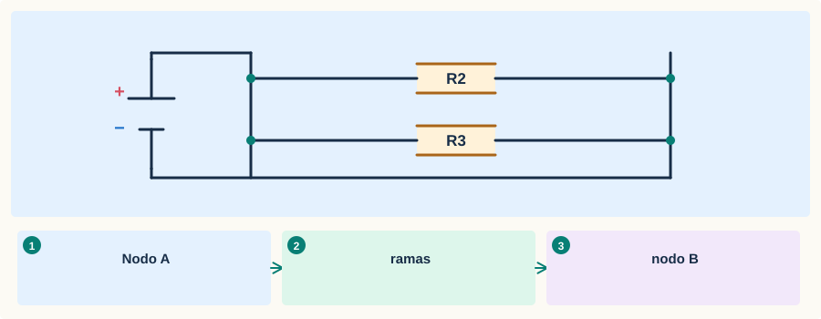

[← Portada](../README.md) · [Índice](../README.md) · [Siguiente →](02.md)

# 01 · Dos nodos comunes

*Diagrama didáctico y secuencia conceptual; no a escala.*

## ¿Qué es y por qué ocurre?

Elementos en paralelo comparten ambos nodos terminales. En el modelo de conductor ideal tienen la misma diferencia de potencial. La corriente puede repartirse entre ramas; los valores no tienen que ser iguales.

## Ejemplo explicado

> Una fuente de 3 V conectada a dos resistores paralelos aplica 3 V a cada uno.

## Ahora tú

Si V1=5 V, ¿V2 en paralelo ideal?

[← Portada](../README.md) · [Índice](../README.md) · [Siguiente →](02.md)
