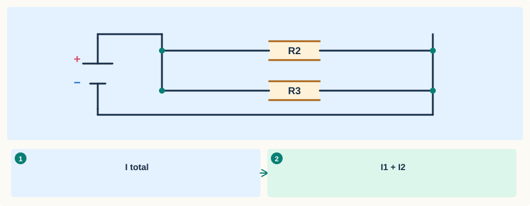
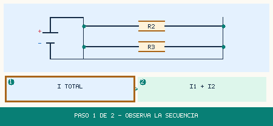

[← Anterior](01.md) · [Índice](../README.md) · [Siguiente →](03.md)

# 02 · Corriente por rama

*Diagrama didáctico y secuencia conceptual; no a escala.*

## ¿Qué es y por qué ocurre?

Usa I1=V/R1 e I2=V/R2. Si una rama tiene menor resistencia, conduce más corriente para la misma tensión. La fuente ideal entrega la suma de corrientes de las ramas.

## Ejemplo explicado

> 3 V sobre 300 Ω y 600 Ω: I1=10 mA, I2=5 mA; total 15 mA.

## Ahora tú

6 V sobre 1 kΩ y 2 kΩ. Calcula ambas I y total.

## Secuencia animada

*Se resaltan etapas del diagrama, no se pretende simular el movimiento físico real.*

[← Anterior](01.md) · [Índice](../README.md) · [Siguiente →](03.md)
