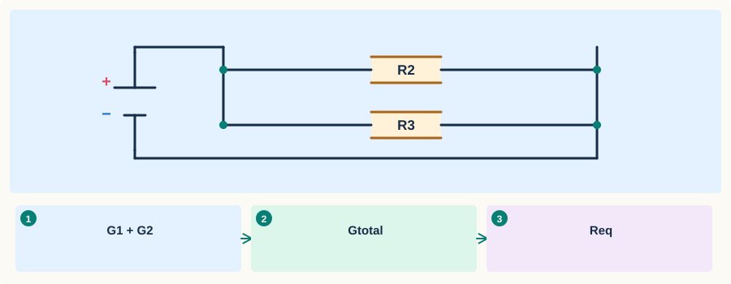

[← Anterior](02.md) · [Índice](../README.md) · [Siguiente →](04.md)

# 03 · Resistencia equivalente y conductancia

*Diagrama didáctico y secuencia conceptual; no a escala.*

## ¿Qué es y por qué ocurre?

De Itotal=V/R1+V/R2 se obtiene 1/Req=1/R1+1/R2. La conductancia G=1/R se mide en siemens (S). Agregar una rama resistiva positiva aumenta conductancia total, por tanto disminuye Req. Para dos: Req=R1R2/(R1+R2).

## Ejemplo explicado

> 300 Ω ||600 Ω =200 Ω, menor que 300 Ω.

## Ahora tú

Calcula 100 Ω ||100 Ω ||100 Ω.

[← Anterior](02.md) · [Índice](../README.md) · [Siguiente →](04.md)
