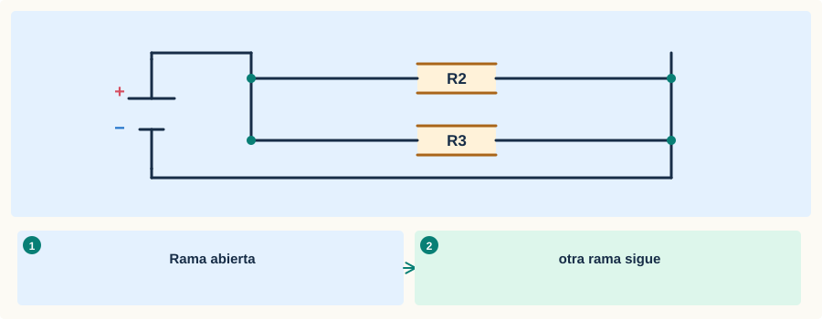

[← Anterior](03.md) · [Índice](../README.md) · [Siguiente →](05.md)

# 04 · Reparto y casos límite

*Diagrama didáctico y secuencia conceptual; no a escala.*

## ¿Qué es y por qué ocurre?

Para dos ramas, I1=It R2/(R1+R2) si solo existen esas dos y son óhmicas. Una rama abierta equivale idealmente a resistencia infinita; su corriente es cero, pero las demás pueden seguir funcionando. Una rama de resistencia muy baja puede sobrecargar la fuente: no se prueba físicamente.

## Ejemplo explicado

> Con dos ramas iguales se reparte It por mitad.

## Ahora tú

Si una de dos ramas iguales se abre, ¿qué sucede con la otra bajo fuente ideal fija?

[← Anterior](03.md) · [Índice](../README.md) · [Siguiente →](05.md)
