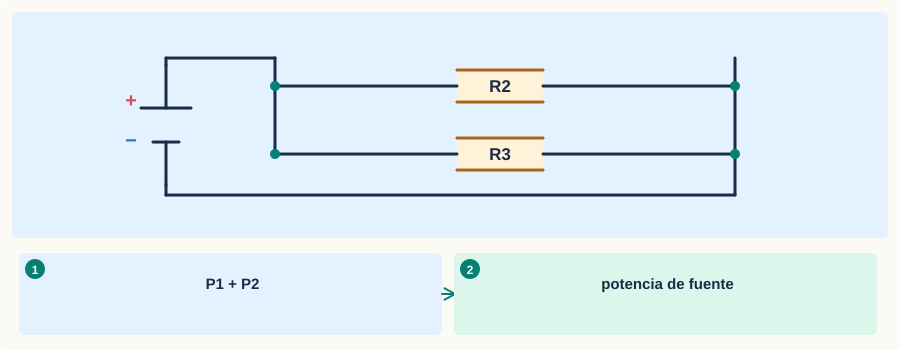

[← Anterior](04.md) · [Índice](../README.md) · [Siguiente →](06.md)

# 05 · Potencia en paralelo

*Diagrama didáctico y secuencia conceptual; no a escala.*

## ¿Qué es y por qué ocurre?

Con tensión común, Pi=V²/Ri. La rama de menor R disipa más potencia si V se mantiene. La suma de potencias es VIt. Una fuente real puede reducir tensión o limitar corriente cuando se agregan cargas.

## Ejemplo explicado

> 3 V sobre 300 y 600 Ω: P1=30 mW, P2=15 mW, total 45 mW.

## Ahora tú

5 V sobre 1 kΩ y 2 kΩ: P total.

[← Anterior](04.md) · [Índice](../README.md) · [Siguiente →](06.md)
