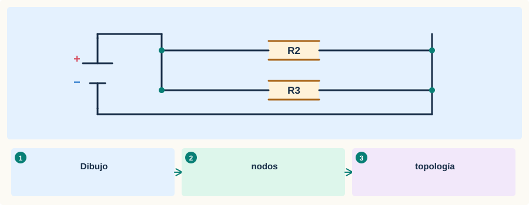

[← Anterior](05.md) · [Índice](../README.md) · [Actividades y cierre →](../descargas.md)

# 06 · Aplicaciones y diagnóstico

*Diagrama didáctico y secuencia conceptual; no a escala.*

## ¿Qué es y por qué ocurre?

En placas y sistemas de alimentación, varias cargas suelen compartir líneas de suministro para funcionar independientemente; no todas se comportan como resistores. Una rama abierta puede dejar otras activas. Para diagnóstico, identifica nodos, compara tensiones y predice corrientes antes de medir.

## Ejemplo explicado

> Dos luces en paralelo ideal: si una se abre, la otra puede mantenerse encendida.

## Ahora tú

¿Por qué no basta ver dos componentes lado a lado para concluir que están en paralelo?

[← Anterior](05.md) · [Índice](../README.md) · [Actividades y cierre →](../descargas.md)
