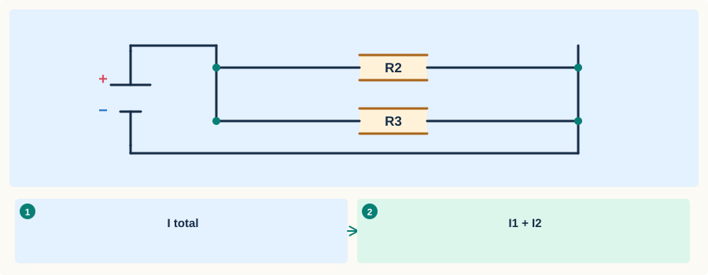

# Práctica guiada · Circuitos en paralelo

**Objetivo:** ¿Por qué añadir una rama reduce el equivalente?

## Procedimiento

Con 3 V limitados y R1=330 Ω, R2=470 Ω, predice I1≈9,09 mA e I2≈6,38 mA, total≈15,47 mA. Monta sin energía, revisa nodos, mide tensión de ambas ramas. Si se autoriza, mide corriente abriendo una rama por vez. No uses corto como prueba.

1. Formula hipótesis y dibuja el modelo antes de intervenir.
2. Identifica magnitudes que cambian y las que permanecen fijas.
3. Realiza solo el procedimiento seguro descrito; registra resultados y unidades.
4. Compara con predicción; explica diferencias, incertidumbre y limitaciones.

| Ensayo | Condiciones | Predicción | Observación o cálculo | Explicación |
|---|---|---|---|---|
| 1 | | | | |
| 2 | | | | |
| 3 | | | | |

Rúbrica: predicción 25, registro 25, explicación 40, presentación 10. Seguridad obligatoria. En simulación, los resultados calculados no son evidencia experimental independiente.

[Simulador complementario PhET](https://phet.colorado.edu/es/simulations/circuit-construction-kit-dc) · [Plantilla de informe](../../../../../plantillas/informe-laboratorio.pdf) · [PDF](015-laboratorio.pdf) · [← Índice](../README.md)
