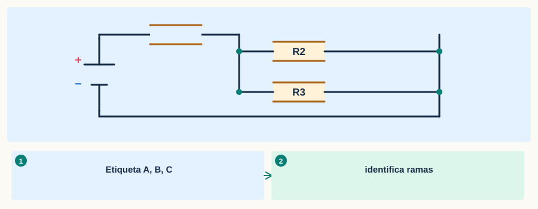
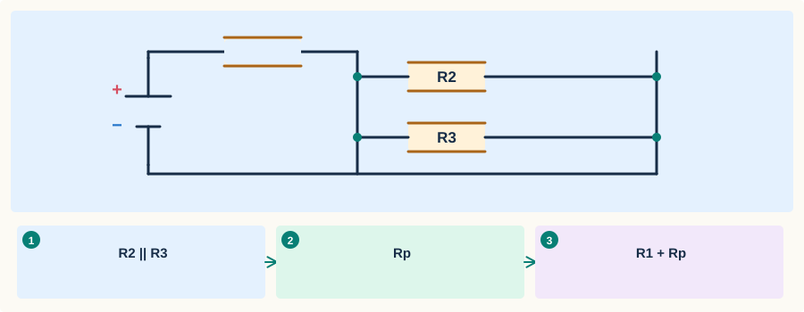
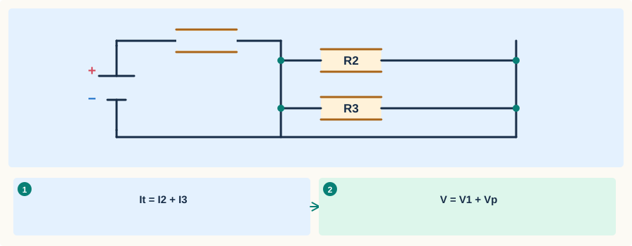
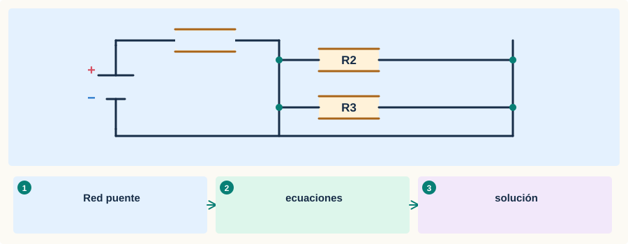
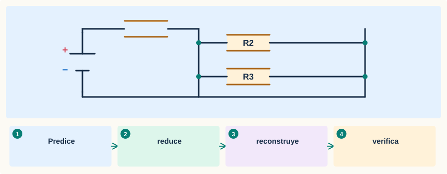

# Cuaderno de ejercicios · Clase 016

[PDF](016-ejercicios.pdf) · [← Índice](../README.md)

## 1. Topología antes de números

**Ejemplo de estudio:** R1 en serie con R2||R3: R2 y R3 comparten nodos, R1 alimenta el conjunto.

**Resuelve:** ¿Dos resistores que comparten un solo nodo con otra rama están en serie necesariamente?

Escribe datos, procedimiento, unidades (si corresponde), dibujo y justificación. No consultes la solución antes.

## 2. Reducción de paralelo

**Ejemplo de estudio:** R2=R3=600 Ω: Rp=300 Ω. R1=300 Ω en serie: Req=600 Ω.

**Resuelve:** R1=100 Ω, R2=200 Ω, R3=200 Ω en paralelo. Calcula Req.

Escribe datos, procedimiento, unidades (si corresponde), dibujo y justificación. No consultes la solución antes.

## 3. Corriente total y reconstrucción

**Ejemplo de estudio:** 6 V y Req=600 Ω: It=10 mA; R1=300 Ω cae 3 V; paralelo tiene 3 V; cada 600 Ω conduce 5 mA.

**Resuelve:** 5 V, R1=100 Ω, R2=R3=200 Ω. Calcula It y corriente de cada rama.

Escribe datos, procedimiento, unidades (si corresponde), dibujo y justificación. No consultes la solución antes.

## 4. Comprobar carga y energía

**Ejemplo de estudio:** En ejemplo 6 V, Pfuente=60 mW; P1=30 mW; P2=P3=15 mW.

**Resuelve:** ¿Si It=20 mA e I2=8 mA, cuánto I3 en nodo sin acumulación?

Escribe datos, procedimiento, unidades (si corresponde), dibujo y justificación. No consultes la solución antes.

## 5. Cuando no hay reducción simple

**Ejemplo de estudio:** Un puente de Wheatstone desequilibrado con rama central no es en general una simple combinación de dos series paralelas.

**Resuelve:** ¿Qué método usar si no puedes identificar grupo serie/paralelo?

Escribe datos, procedimiento, unidades (si corresponde), dibujo y justificación. No consultes la solución antes.

## 6. Interpretar resultados físicos

**Ejemplo de estudio:** En serie con 100 Ω y paralelo de dos 200 Ω, Req=200 Ω; el paralelo aislado vale 100 Ω.

**Resuelve:** Si agregas una tercera rama de 200 Ω al paralelo, ¿Req total sube o baja?

Escribe datos, procedimiento, unidades (si corresponde), dibujo y justificación. No consultes la solución antes.
