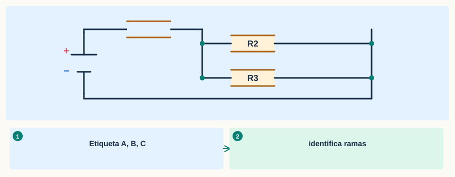
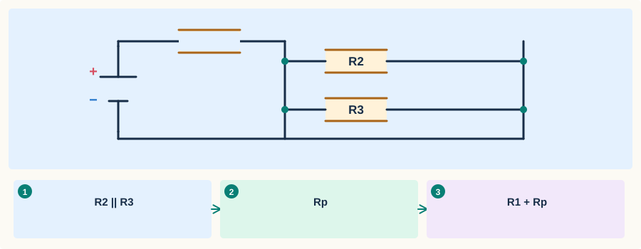
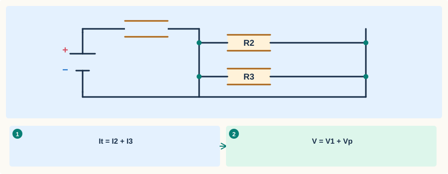
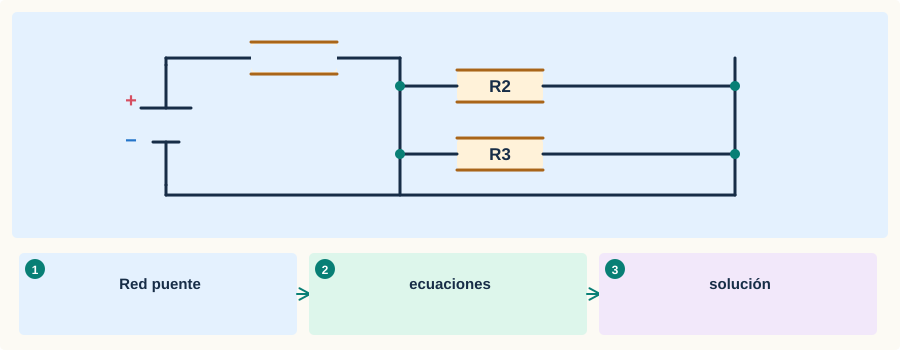
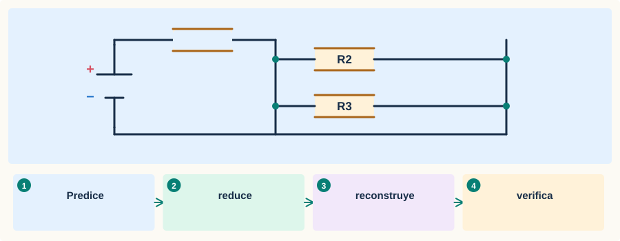

# Circuitos mixtos

[← Índice](../README.md)

## 01 · Topología antes de números

Un circuito mixto tiene combinaciones serie y paralelo. Etiqueta nodos antes de reducir: dos resistores están en paralelo si comparten ambos nodos; están en serie si el nodo intermedio no tiene otra rama que conduzca. No se identifican por orientación visual.

**Ejemplo:** R1 en serie con R2||R3: R2 y R3 comparten nodos, R1 alimenta el conjunto.

**Aplica:** ¿Dos resistores que comparten un solo nodo con otra rama están en serie necesariamente?

---

## 02 · Reducción de paralelo

Primero reduce un grupo de paralelo claramente identificable; luego combina con los elementos en serie. Conserva el mapa de qué resistencia representa cada grupo.

**Ejemplo:** R2=R3=600 Ω: Rp=300 Ω. R1=300 Ω en serie: Req=600 Ω.

**Aplica:** R1=100 Ω, R2=200 Ω, R3=200 Ω en paralelo. Calcula Req.

---

## 03 · Corriente total y reconstrucción

Una vez hallado Req, It=V/Req. Después deshaz reducciones para hallar tensiones y corrientes originales. En R1 serie pasa It; en grupo paralelo Vp=ItRp, con I2=Vp/R2 e I3=Vp/R3.

**Ejemplo:** 6 V y Req=600 Ω: It=10 mA; R1=300 Ω cae 3 V; paralelo tiene 3 V; cada 600 Ω conduce 5 mA.

**Aplica:** 5 V, R1=100 Ω, R2=R3=200 Ω. Calcula It y corriente de cada rama.

---

## 04 · Comprobar carga y energía

Verifica It=I2+I3 y Vfuente=V1+Vp. Calcula Pi=ViIi; la suma de potencias debe igualar VfuenteIt en el modelo ideal. Estos balances detectan errores de reducción o unidades.

**Ejemplo:** En ejemplo 6 V, Pfuente=60 mW; P1=30 mW; P2=P3=15 mW.

**Aplica:** ¿Si It=20 mA e I2=8 mA, cuánto I3 en nodo sin acumulación?

---

## 05 · Cuando no hay reducción simple

Una red puente puede no reducirse solo con serie y paralelo: las ramas intermedias comparten nodos con más conexiones. No fuerces una reducción incorrecta; se pueden usar ecuaciones de Kirchhoff, análisis nodal o de mallas. Esas herramientas vienen a continuación.

**Ejemplo:** Un puente de Wheatstone desequilibrado con rama central no es en general una simple combinación de dos series paralelas.

**Aplica:** ¿Qué método usar si no puedes identificar grupo serie/paralelo?

---

## 06 · Interpretar resultados físicos

Un resultado de Req en paralelo mayor que la menor rama indica error. Una caída negativa puede ser correcta si la referencia se invirtió; no lo es una potencia disipada negativa en resistor con convención pasiva. Comparar predicción con medida requiere tolerancia e incertidumbre.

**Ejemplo:** En serie con 100 Ω y paralelo de dos 200 Ω, Req=200 Ω; el paralelo aislado vale 100 Ω.

**Aplica:** Si agregas una tercera rama de 200 Ω al paralelo, ¿Req total sube o baja?

---
