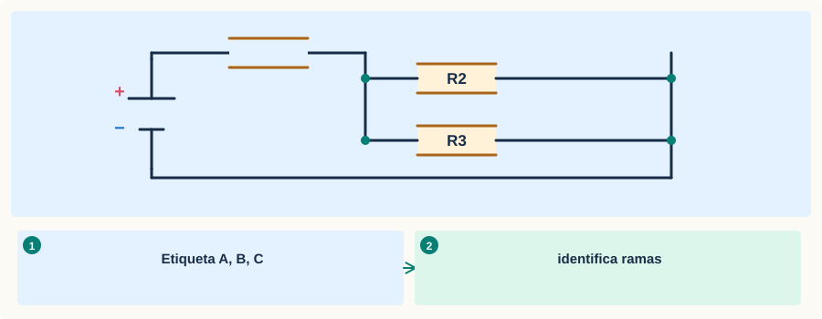

[← Portada](../README.md) · [Índice](../README.md) · [Siguiente →](02.md)

# 01 · Topología antes de números

*Diagrama didáctico y secuencia conceptual; no a escala.*

## ¿Qué es y por qué ocurre?

Un circuito mixto tiene combinaciones serie y paralelo. Etiqueta nodos antes de reducir: dos resistores están en paralelo si comparten ambos nodos; están en serie si el nodo intermedio no tiene otra rama que conduzca. No se identifican por orientación visual.

## Ejemplo explicado

> R1 en serie con R2||R3: R2 y R3 comparten nodos, R1 alimenta el conjunto.

## Ahora tú

¿Dos resistores que comparten un solo nodo con otra rama están en serie necesariamente?

[← Portada](../README.md) · [Índice](../README.md) · [Siguiente →](02.md)
