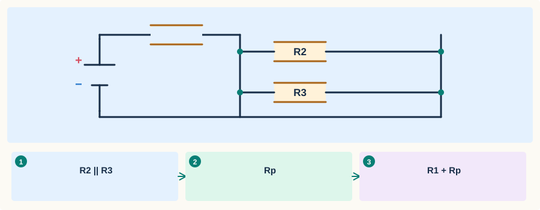
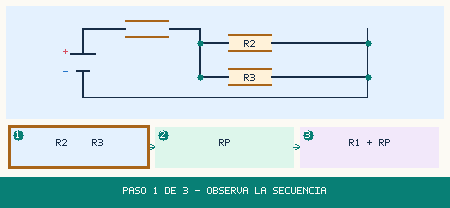

[← Anterior](01.md) · [Índice](../README.md) · [Siguiente →](03.md)

# 02 · Reducción de paralelo

*Diagrama didáctico y secuencia conceptual; no a escala.*

## ¿Qué es y por qué ocurre?

Primero reduce un grupo de paralelo claramente identificable; luego combina con los elementos en serie. Conserva el mapa de qué resistencia representa cada grupo.

## Ejemplo explicado

> R2=R3=600 Ω: Rp=300 Ω. R1=300 Ω en serie: Req=600 Ω.

## Ahora tú

R1=100 Ω, R2=200 Ω, R3=200 Ω en paralelo. Calcula Req.

## Secuencia animada

*Se resaltan etapas del diagrama, no se pretende simular el movimiento físico real.*

[← Anterior](01.md) · [Índice](../README.md) · [Siguiente →](03.md)
