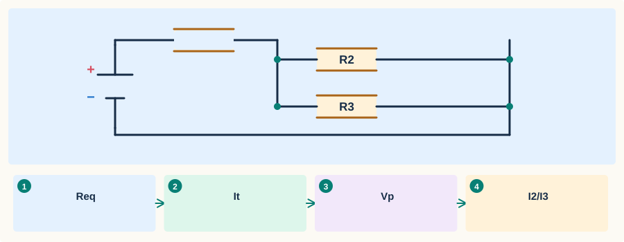

[← Anterior](02.md) · [Índice](../README.md) · [Siguiente →](04.md)

# 03 · Corriente total y reconstrucción

*Diagrama didáctico y secuencia conceptual; no a escala.*

## ¿Qué es y por qué ocurre?

Una vez hallado Req, It=V/Req. Después deshaz reducciones para hallar tensiones y corrientes originales. En R1 serie pasa It; en grupo paralelo Vp=ItRp, con I2=Vp/R2 e I3=Vp/R3.

## Ejemplo explicado

> 6 V y Req=600 Ω: It=10 mA; R1=300 Ω cae 3 V; paralelo tiene 3 V; cada 600 Ω conduce 5 mA.

## Ahora tú

5 V, R1=100 Ω, R2=R3=200 Ω. Calcula It y corriente de cada rama.

[← Anterior](02.md) · [Índice](../README.md) · [Siguiente →](04.md)
