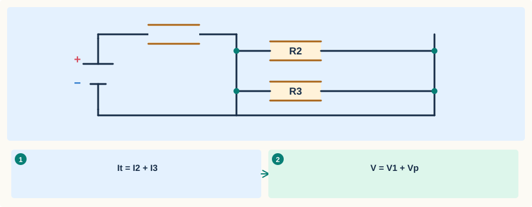

[← Anterior](03.md) · [Índice](../README.md) · [Siguiente →](05.md)

# 04 · Comprobar carga y energía

*Diagrama didáctico y secuencia conceptual; no a escala.*

## ¿Qué es y por qué ocurre?

Verifica It=I2+I3 y Vfuente=V1+Vp. Calcula Pi=ViIi; la suma de potencias debe igualar VfuenteIt en el modelo ideal. Estos balances detectan errores de reducción o unidades.

## Ejemplo explicado

> En ejemplo 6 V, Pfuente=60 mW; P1=30 mW; P2=P3=15 mW.

## Ahora tú

¿Si It=20 mA e I2=8 mA, cuánto I3 en nodo sin acumulación?

[← Anterior](03.md) · [Índice](../README.md) · [Siguiente →](05.md)
