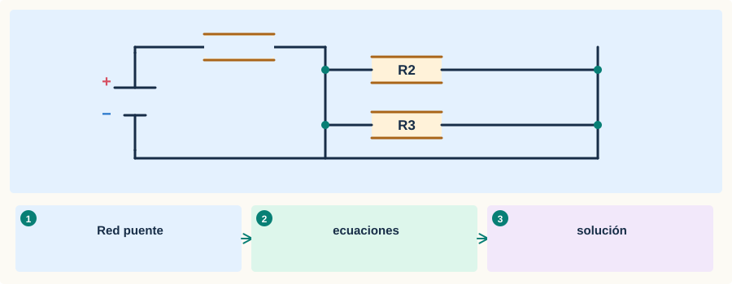

[← Anterior](04.md) · [Índice](../README.md) · [Siguiente →](06.md)

# 05 · Cuando no hay reducción simple

*Diagrama didáctico y secuencia conceptual; no a escala.*

## ¿Qué es y por qué ocurre?

Una red puente puede no reducirse solo con serie y paralelo: las ramas intermedias comparten nodos con más conexiones. No fuerces una reducción incorrecta; se pueden usar ecuaciones de Kirchhoff, análisis nodal o de mallas. Esas herramientas vienen a continuación.

## Ejemplo explicado

> Un puente de Wheatstone desequilibrado con rama central no es en general una simple combinación de dos series paralelas.

## Ahora tú

¿Qué método usar si no puedes identificar grupo serie/paralelo?

[← Anterior](04.md) · [Índice](../README.md) · [Siguiente →](06.md)
