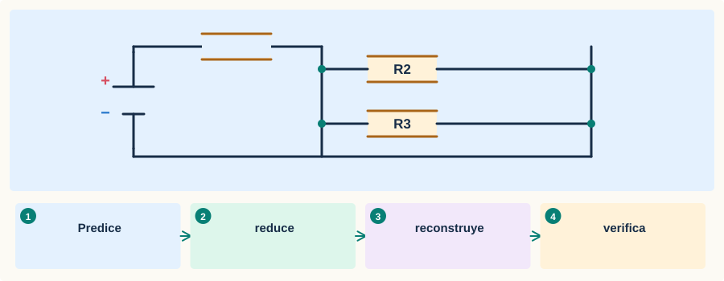

[← Anterior](05.md) · [Índice](../README.md) · [Actividades y cierre →](../descargas.md)

# 06 · Interpretar resultados físicos

*Diagrama didáctico y secuencia conceptual; no a escala.*

## ¿Qué es y por qué ocurre?

Un resultado de Req en paralelo mayor que la menor rama indica error. Una caída negativa puede ser correcta si la referencia se invirtió; no lo es una potencia disipada negativa en resistor con convención pasiva. Comparar predicción con medida requiere tolerancia e incertidumbre.

## Ejemplo explicado

> En serie con 100 Ω y paralelo de dos 200 Ω, Req=200 Ω; el paralelo aislado vale 100 Ω.

## Ahora tú

Si agregas una tercera rama de 200 Ω al paralelo, ¿Req total sube o baja?

[← Anterior](05.md) · [Índice](../README.md) · [Actividades y cierre →](../descargas.md)
