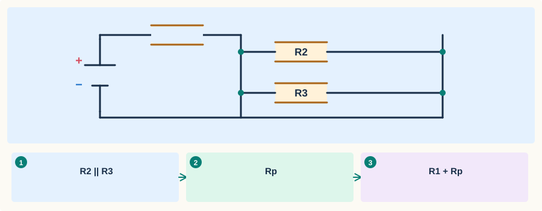

# Práctica guiada · Circuitos mixtos

**Objetivo:** ¿Cómo reconocer conexiones aunque cambie el dibujo?

## Procedimiento

Con fuente 3 V limitada, R1=330 Ω y R2=R3=680 Ω, calcula Rp=340 Ω, Req=670 Ω, It≈4,48 mA, Vp≈1,52 V. Monta tras revisión; mide V1 y Vp y verifica suma. Desenergiza antes de cambiar cableado.

1. Formula hipótesis y dibuja el modelo antes de intervenir.
2. Identifica magnitudes que cambian y las que permanecen fijas.
3. Realiza solo el procedimiento seguro descrito; registra resultados y unidades.
4. Compara con predicción; explica diferencias, incertidumbre y limitaciones.

| Ensayo | Condiciones | Predicción | Observación o cálculo | Explicación |
|---|---|---|---|---|
| 1 | | | | |
| 2 | | | | |
| 3 | | | | |

Rúbrica: predicción 25, registro 25, explicación 40, presentación 10. Seguridad obligatoria. En simulación, los resultados calculados no son evidencia experimental independiente.

[Simulador complementario PhET](https://phet.colorado.edu/es/simulations/circuit-construction-kit-dc) · [Plantilla de informe](../../../../../plantillas/informe-laboratorio.pdf) · [PDF](016-laboratorio.pdf) · [← Índice](../README.md)
