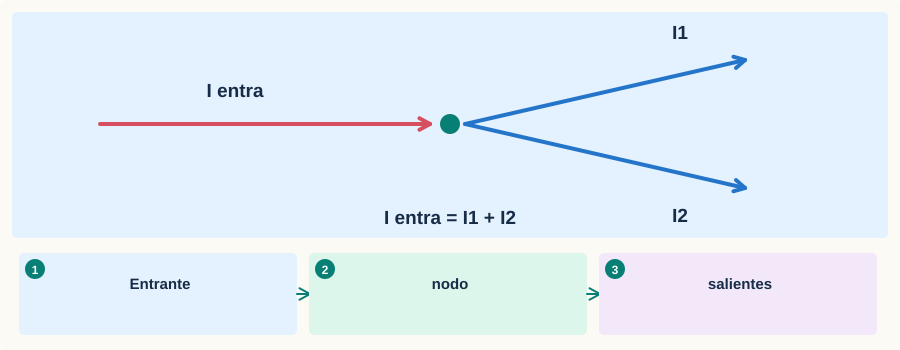

[← Clase 016](../016-circuitos-mixtos/README.md) · [Índice](../README.md) · [Clase 018 →](../018-kirchhoff-voltajes/README.md)

# Clase 017 · Primera ley de Kirchhoff: conservación de la carga

**6 temas desarrollados · 120–180 min orientativos, ampliables por dominio.**

> ¿Por qué la suma algebraica de corrientes es cero en un nodo sin acumulación?

[▶ Comenzar a leer](libro/01.md) · [Libro web](https://mangelmorenomoreno.github.io/academia-sistemas/modulos/01-electronica-basica/clases/017-kirchhoff-corrientes/libro.html) · [Descargas](descargas.md)

| Página | Tema |
|---|---|
| 01 | [Carga no desaparece en un nodo](libro/01.md) |
| 02 | [Convención de signos](libro/02.md) |
| 03 | [Ejemplo con una incógnita](libro/03.md) |
| 04 | [Dos nodos y ley de Ohm](libro/04.md) |
| 05 | [Corriente negativa y comprobación](libro/05.md) |
| 06 | [De los nodos al hardware](libro/06.md) |

## Material de estudio

[Lectura completa](lecturas/guia-ampliada.md) · [Presentación web](https://mangelmorenomoreno.github.io/academia-sistemas/modulos/01-electronica-basica/clases/017-kirchhoff-corrientes/presentacion.html) · [Ejercicios](ejercicios/README.md) · [Práctica](practicas/README.md) · [Evaluación](pruebas/README.md) · [Soluciones](soluciones/README.md) · [Guía docente](guia-docente.md) · [Recursos](recursos/videos-y-simulaciones.md)

> [!CAUTION]
> Prácticas físicas solo con baja tensión, fuente limitada o apropiada y supervisión; desenergiza antes de modificar conexiones. Nunca trabajar con la red doméstica, provocar cortos ni utilizar componentes dañados.

[← Clase 016](../016-circuitos-mixtos/README.md) · [Índice](../README.md) · [Clase 018 →](../018-kirchhoff-voltajes/README.md)
