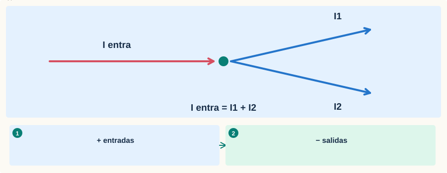
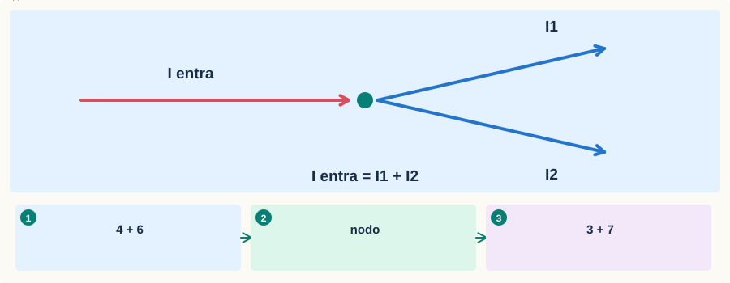
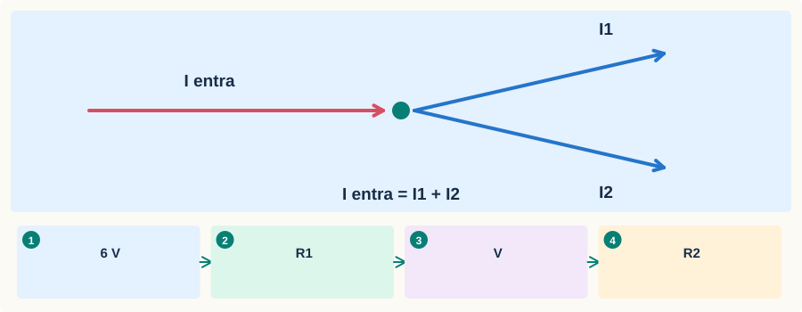
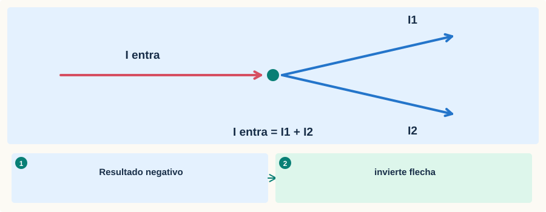
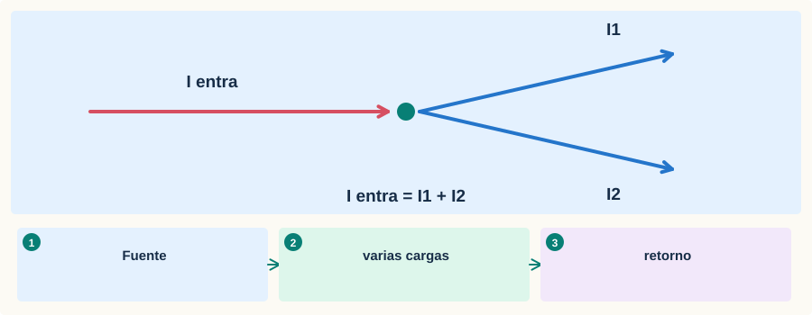

# Cuaderno de ejercicios · Clase 017

[PDF](017-ejercicios.pdf) · [← Índice](../README.md)

## 1. Carga no desaparece en un nodo

**Ejemplo de estudio:** Si entran 5 mA y salen 3 mA por una rama, deben salir otros 2 mA si no hay acumulación.

**Resuelve:** Entran 12 mA y salen 7 mA. Falta ¿cuánto?

Escribe datos, procedimiento, unidades (si corresponde), dibujo y justificación. No consultes la solución antes.

## 2. Convención de signos

**Ejemplo de estudio:** +8−3−I=0 en mA: I=5 mA saliente.

**Resuelve:** +10−6−Ix=0. Calcula Ix.

Escribe datos, procedimiento, unidades (si corresponde), dibujo y justificación. No consultes la solución antes.

## 3. Ejemplo con una incógnita

**Ejemplo de estudio:** Si asumiste Ix entrante en lugar de saliente, saldría −7 mA.

**Resuelve:** Entran 3 y 9 mA, salen 2 mA y X. Calcula X.

Escribe datos, procedimiento, unidades (si corresponde), dibujo y justificación. No consultes la solución antes.

## 4. Dos nodos y ley de Ohm

**Ejemplo de estudio:** Nodo V conectado a 6 V por 1 kΩ y a 0 V por 2 kΩ: (6−V)/1000=V/2000; V=4 V.

**Resuelve:** Nodo V entre 9 V por 2 kΩ y 0 V por 1 kΩ. Calcula V.

Escribe datos, procedimiento, unidades (si corresponde), dibujo y justificación. No consultes la solución antes.

## 5. Corriente negativa y comprobación

**Ejemplo de estudio:** Si asumes I saliente y obtienes −2 mA, realmente entran 2 mA.

**Resuelve:** Si entran 8 mA y solo salen 5 mA en un modelo con acumulación, calcula dQ/dt.

Escribe datos, procedimiento, unidades (si corresponde), dibujo y justificación. No consultes la solución antes.

## 6. De los nodos al hardware

**Ejemplo de estudio:** Tres cargas de 10, 20 y 30 mA en paralelo ideal requieren 60 mA en total.

**Resuelve:** ¿Qué verifica KCL en una alimentación con varias cargas?

Escribe datos, procedimiento, unidades (si corresponde), dibujo y justificación. No consultes la solución antes.
