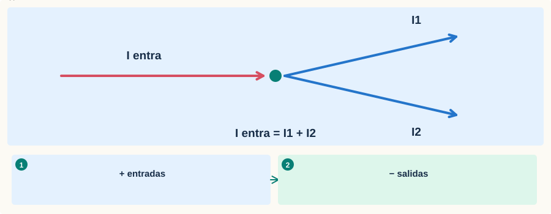
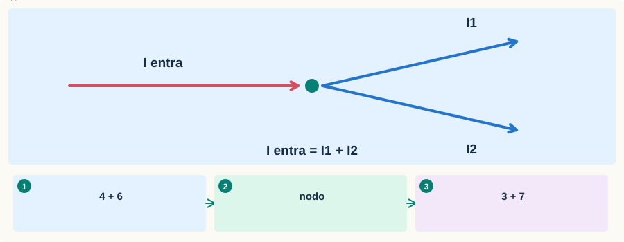
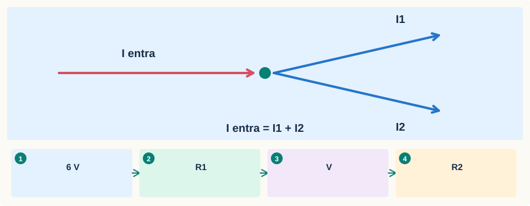
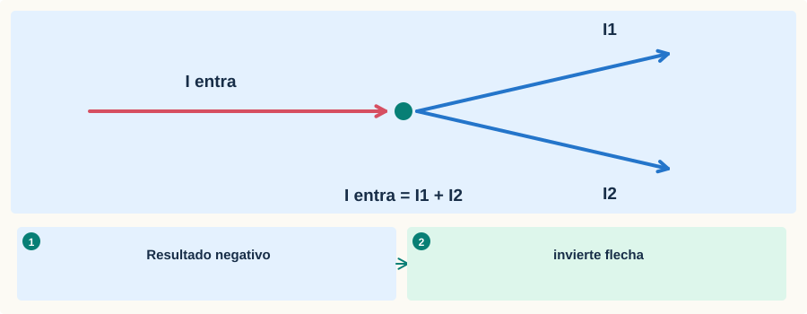
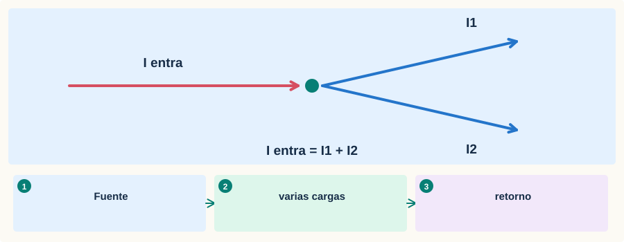

# Primera ley de Kirchhoff: conservación de la carga

[← Índice](../README.md)

## 01 · Carga no desaparece en un nodo

Un nodo ideal une ramas. La conservación exige dQnodo/dt=ΣIentrante−ΣIsaliente. En régimen estacionario o modelo concentrado sin acumulación neta en el nodo, esa diferencia es cero. En transitorios, la acumulación debe representarse mediante elementos o modelos adecuados.

**Ejemplo:** Si entran 5 mA y salen 3 mA por una rama, deben salir otros 2 mA si no hay acumulación.

**Aplica:** Entran 12 mA y salen 7 mA. Falta ¿cuánto?

---

## 02 · Convención de signos

Elige, por ejemplo, corrientes entrantes positivas y salientes negativas. Escribe ΣI=0. Puedes escoger sentidos iniciales arbitrarios para incógnitas; un resultado negativo significa que el sentido real es opuesto al supuesto.

**Ejemplo:** +8−3−I=0 en mA: I=5 mA saliente.

**Aplica:** +10−6−Ix=0. Calcula Ix.

---

## 03 · Ejemplo con una incógnita

Dibuja flechas antes de la ecuación. Si entran 4 mA y 6 mA, y salen 3 mA e Ix, 4+6−3−Ix=0. Despeja Ix=7 mA. Verifica suma: 10 mA entran y 10 salen.

**Ejemplo:** Si asumiste Ix entrante en lugar de saliente, saldría −7 mA.

**Aplica:** Entran 3 y 9 mA, salen 2 mA y X. Calcula X.

---

## 04 · Dos nodos y ley de Ohm

Para hallar tensiones nodales, expresa cada corriente en términos de diferencias de potencial: IAB=(VA−VB)/R. Luego aplica KCL. Elige un nodo de referencia 0 V. En una red resistiva simple, una ecuación puede determinar el nodo desconocido.

**Ejemplo:** Nodo V conectado a 6 V por 1 kΩ y a 0 V por 2 kΩ: (6−V)/1000=V/2000; V=4 V.

**Aplica:** Nodo V entre 9 V por 2 kΩ y 0 V por 1 kΩ. Calcula V.

---

## 05 · Corriente negativa y comprobación

Una incógnita negativa no implica que la carga se destruya: corrige el sentido. Comprueba dimensiones A o mA coherentes. No sumes voltajes en una ecuación de corrientes. Si un nodo presenta acumulación real, dQ/dt no es cero en la descripción que la incluye explícitamente.

**Ejemplo:** Si asumes I saliente y obtienes −2 mA, realmente entran 2 mA.

**Aplica:** Si entran 8 mA y solo salen 5 mA en un modelo con acumulación, calcula dQ/dt.

---

## 06 · De los nodos al hardware

En una placa, las corrientes de múltiples cargas se distribuyen desde líneas de alimentación y regresan por sus caminos de retorno. Dimensionar conductores y fuente requiere conocer corriente total; las señales rápidas necesitan modelos más avanzados que un nodo ideal.

**Ejemplo:** Tres cargas de 10, 20 y 30 mA en paralelo ideal requieren 60 mA en total.

**Aplica:** ¿Qué verifica KCL en una alimentación con varias cargas?

---
