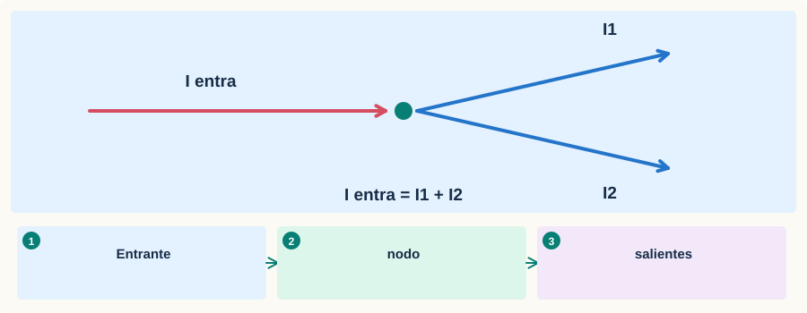

[← Portada](../README.md) · [Índice](../README.md) · [Siguiente →](02.md)

# 01 · Carga no desaparece en un nodo

*Diagrama didáctico y secuencia conceptual; no a escala.*

## ¿Qué es y por qué ocurre?

Un nodo ideal une ramas. La conservación exige dQnodo/dt=ΣIentrante−ΣIsaliente. En régimen estacionario o modelo concentrado sin acumulación neta en el nodo, esa diferencia es cero. En transitorios, la acumulación debe representarse mediante elementos o modelos adecuados.

## Ejemplo explicado

> Si entran 5 mA y salen 3 mA por una rama, deben salir otros 2 mA si no hay acumulación.

## Ahora tú

Entran 12 mA y salen 7 mA. Falta ¿cuánto?

[← Portada](../README.md) · [Índice](../README.md) · [Siguiente →](02.md)
