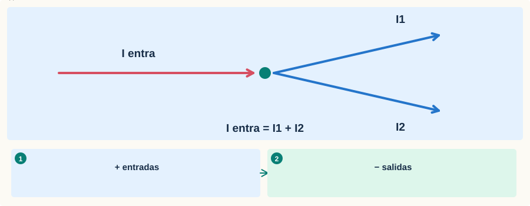
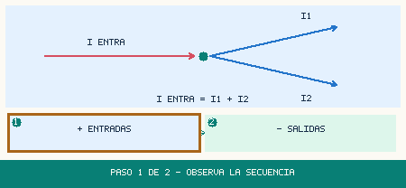

[← Anterior](01.md) · [Índice](../README.md) · [Siguiente →](03.md)

# 02 · Convención de signos

*Diagrama didáctico y secuencia conceptual; no a escala.*

## ¿Qué es y por qué ocurre?

Elige, por ejemplo, corrientes entrantes positivas y salientes negativas. Escribe ΣI=0. Puedes escoger sentidos iniciales arbitrarios para incógnitas; un resultado negativo significa que el sentido real es opuesto al supuesto.

## Ejemplo explicado

> +8−3−I=0 en mA: I=5 mA saliente.

## Ahora tú

+10−6−Ix=0. Calcula Ix.

## Secuencia animada

*Se resaltan etapas del diagrama, no se pretende simular el movimiento físico real.*

[← Anterior](01.md) · [Índice](../README.md) · [Siguiente →](03.md)
