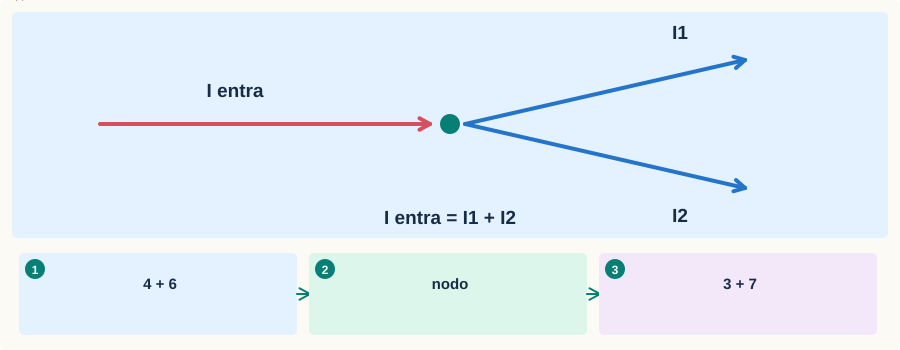

[← Anterior](02.md) · [Índice](../README.md) · [Siguiente →](04.md)

# 03 · Ejemplo con una incógnita

*Diagrama didáctico y secuencia conceptual; no a escala.*

## ¿Qué es y por qué ocurre?

Dibuja flechas antes de la ecuación. Si entran 4 mA y 6 mA, y salen 3 mA e Ix, 4+6−3−Ix=0. Despeja Ix=7 mA. Verifica suma: 10 mA entran y 10 salen.

## Ejemplo explicado

> Si asumiste Ix entrante en lugar de saliente, saldría −7 mA.

## Ahora tú

Entran 3 y 9 mA, salen 2 mA y X. Calcula X.

[← Anterior](02.md) · [Índice](../README.md) · [Siguiente →](04.md)
