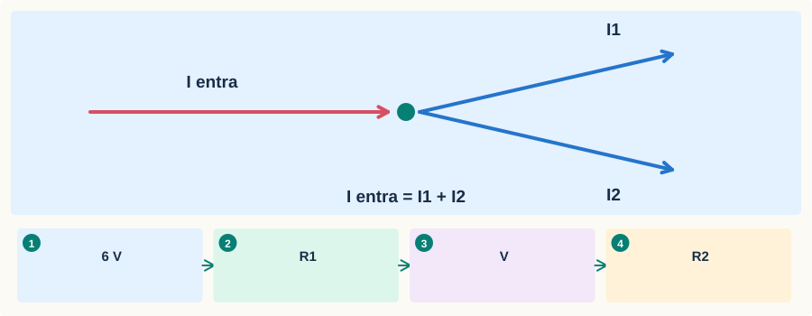

[← Anterior](03.md) · [Índice](../README.md) · [Siguiente →](05.md)

# 04 · Dos nodos y ley de Ohm

*Diagrama didáctico y secuencia conceptual; no a escala.*

## ¿Qué es y por qué ocurre?

Para hallar tensiones nodales, expresa cada corriente en términos de diferencias de potencial: IAB=(VA−VB)/R. Luego aplica KCL. Elige un nodo de referencia 0 V. En una red resistiva simple, una ecuación puede determinar el nodo desconocido.

## Ejemplo explicado

> Nodo V conectado a 6 V por 1 kΩ y a 0 V por 2 kΩ: (6−V)/1000=V/2000; V=4 V.

## Ahora tú

Nodo V entre 9 V por 2 kΩ y 0 V por 1 kΩ. Calcula V.

[← Anterior](03.md) · [Índice](../README.md) · [Siguiente →](05.md)
