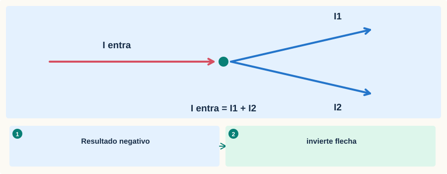

[← Anterior](04.md) · [Índice](../README.md) · [Siguiente →](06.md)

# 05 · Corriente negativa y comprobación

*Diagrama didáctico y secuencia conceptual; no a escala.*

## ¿Qué es y por qué ocurre?

Una incógnita negativa no implica que la carga se destruya: corrige el sentido. Comprueba dimensiones A o mA coherentes. No sumes voltajes en una ecuación de corrientes. Si un nodo presenta acumulación real, dQ/dt no es cero en la descripción que la incluye explícitamente.

## Ejemplo explicado

> Si asumes I saliente y obtienes −2 mA, realmente entran 2 mA.

## Ahora tú

Si entran 8 mA y solo salen 5 mA en un modelo con acumulación, calcula dQ/dt.

[← Anterior](04.md) · [Índice](../README.md) · [Siguiente →](06.md)
