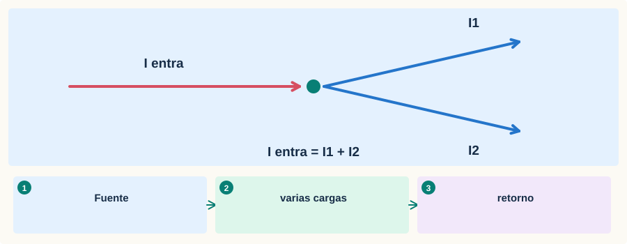

[← Anterior](05.md) · [Índice](../README.md) · [Actividades y cierre →](../descargas.md)

# 06 · De los nodos al hardware

*Diagrama didáctico y secuencia conceptual; no a escala.*

## ¿Qué es y por qué ocurre?

En una placa, las corrientes de múltiples cargas se distribuyen desde líneas de alimentación y regresan por sus caminos de retorno. Dimensionar conductores y fuente requiere conocer corriente total; las señales rápidas necesitan modelos más avanzados que un nodo ideal.

## Ejemplo explicado

> Tres cargas de 10, 20 y 30 mA en paralelo ideal requieren 60 mA en total.

## Ahora tú

¿Qué verifica KCL en una alimentación con varias cargas?

[← Anterior](05.md) · [Índice](../README.md) · [Actividades y cierre →](../descargas.md)
