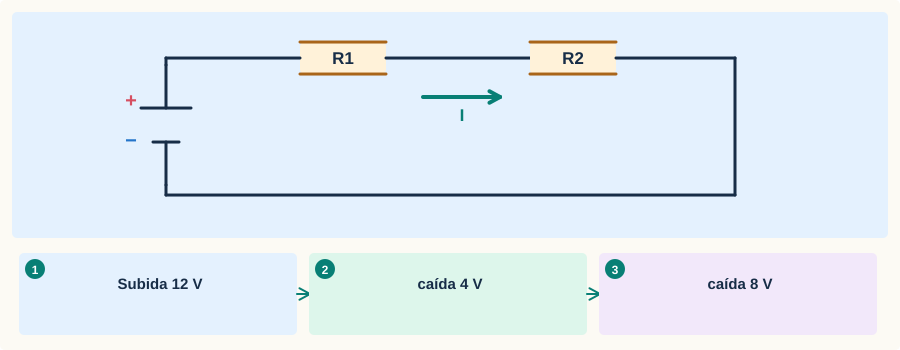
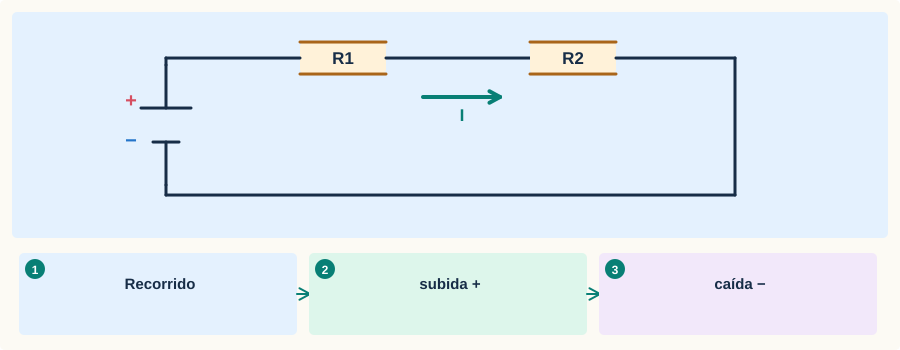
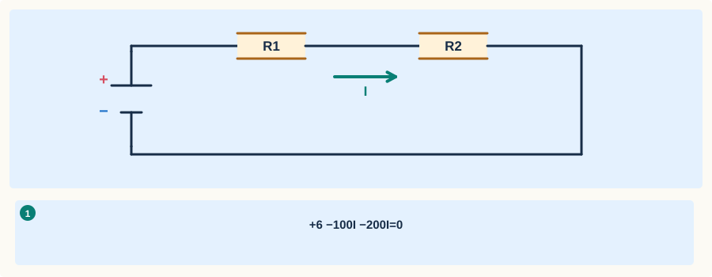
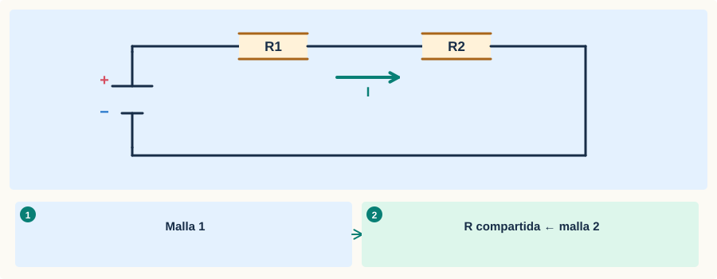
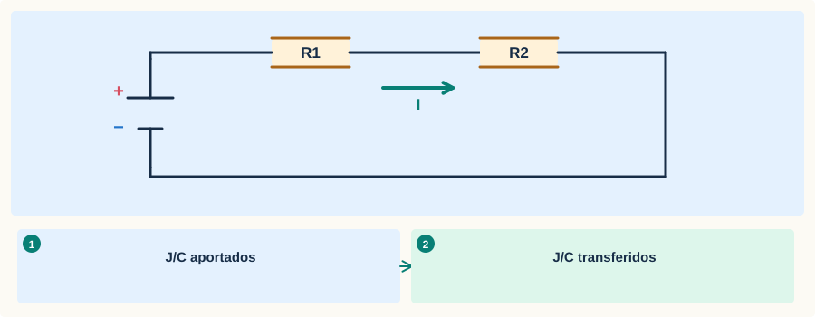
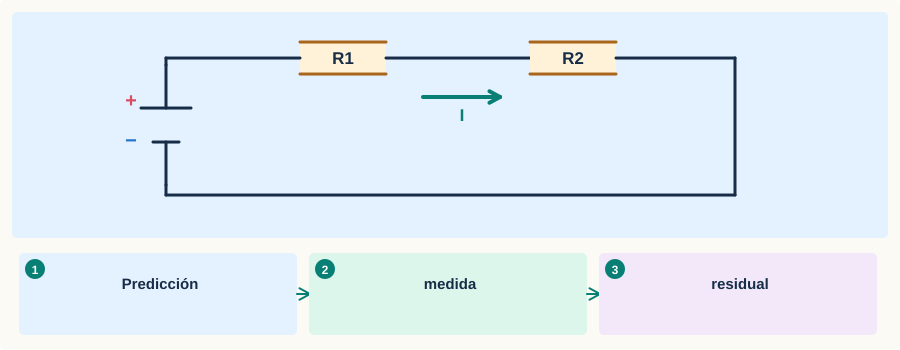

# Cuaderno de ejercicios · Clase 018

[PDF](018-ejercicios.pdf) · [← Índice](../README.md)

## 1. Balance por unidad de carga

**Ejemplo de estudio:** 12 V de fuente y caídas 4 V y 8 V: 12−4−8=0 V.

**Resuelve:** Fuente 9 V y caída 3 V. ¿Otra caída en lazo simple?

Escribe datos, procedimiento, unidades (si corresponde), dibujo y justificación. No consultes la solución antes.

## 2. Signos al recorrer una malla

**Ejemplo de estudio:** Recorrido de pila − a + de 6 V y resistor en sentido de I: +6−IR=0.

**Resuelve:** ¿Qué signo tiene una caída de 2 V recorrida de − a +?

Escribe datos, procedimiento, unidades (si corresponde), dibujo y justificación. No consultes la solución antes.

## 3. Una malla, una corriente

**Ejemplo de estudio:** Pfuente=0,12 W; P1=0,04 W y P2=0,08 W.

**Resuelve:** 9 V, 300 Ω y 600 Ω. Resuelve I y caídas.

Escribe datos, procedimiento, unidades (si corresponde), dibujo y justificación. No consultes la solución antes.

## 4. Dos mallas: elemento compartido

**Ejemplo de estudio:** Con R1=R2=Rcomp=1 kΩ, fuentes orientadas para subidas de 6 V y 0 V: 2I1−I2=6; −I1+2I2=0 (I en mA). I1=4 mA, I2=2 mA.

**Resuelve:** En el ejemplo, ¿corriente en resistor común según primera malla?

Escribe datos, procedimiento, unidades (si corresponde), dibujo y justificación. No consultes la solución antes.

## 5. Energía, potencia y límites

**Ejemplo de estudio:** Una fuente de 3 V transfiere 3 J por C; dos caídas de 1 V y 2 V transfieren 1 y 2 J por C.

**Resuelve:** ¿Qué unidad sumas en KVL y cuál en KCL?

Escribe datos, procedimiento, unidades (si corresponde), dibujo y justificación. No consultes la solución antes.

## 6. Diagnóstico de una malla

**Ejemplo de estudio:** Medidas 3,02 V, 1,20 V y 1,80 V dan residual 0,02 V.

**Resuelve:** ¿Residual 0,02 V prueba automáticamente violación de conservación?

Escribe datos, procedimiento, unidades (si corresponde), dibujo y justificación. No consultes la solución antes.
