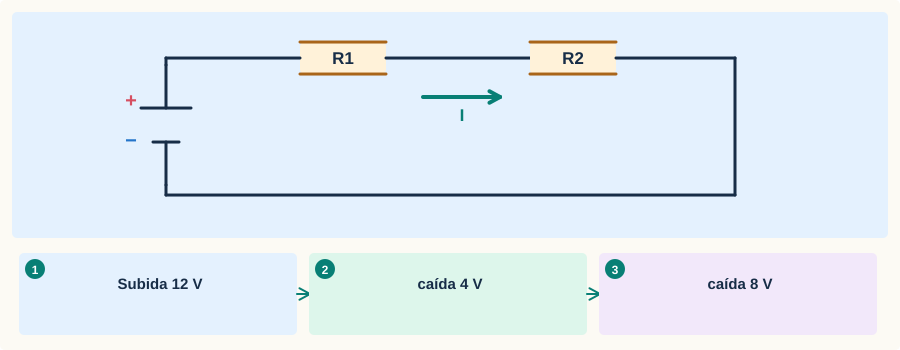
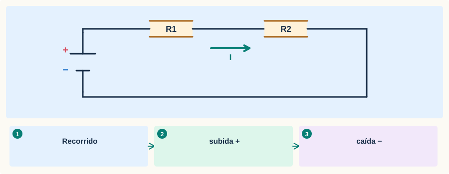
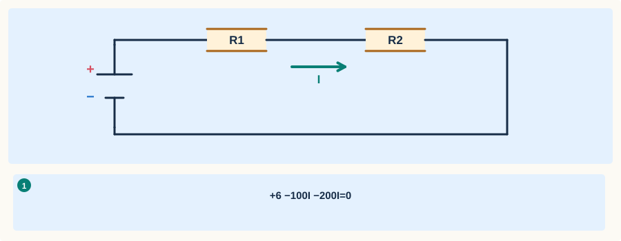
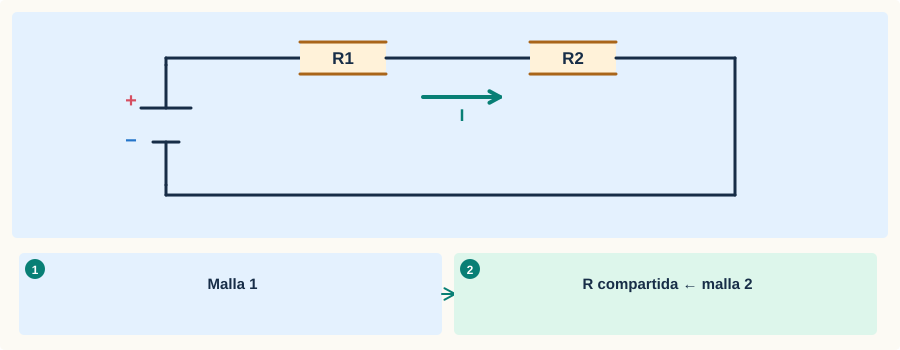
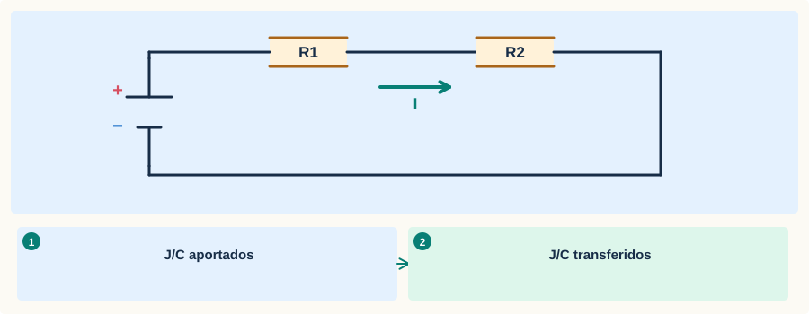
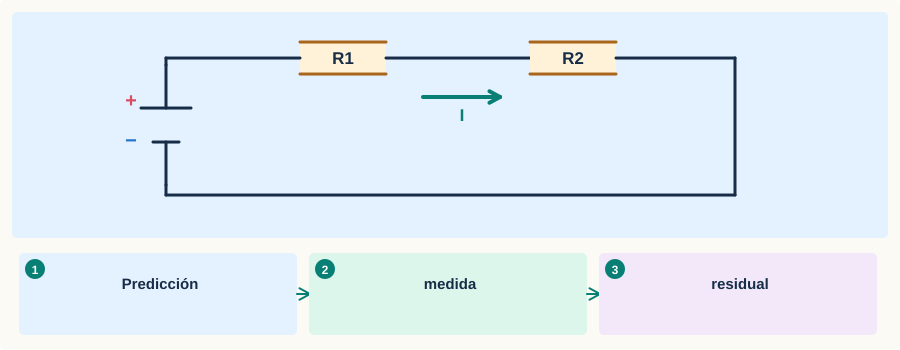

# Segunda ley de Kirchhoff: balance de energía

[← Índice](../README.md)

## 01 · Balance por unidad de carga

En un lazo de circuito concentrado bajo condiciones habituales (sin flujo magnético variable externo enlazado no modelado), la suma algebraica de tensiones es cero. Una fuente aporta energía por carga y las caídas representan transferencias. Es distinto de KCL: esta suma está en voltios.

**Ejemplo:** 12 V de fuente y caídas 4 V y 8 V: 12−4−8=0 V.

**Aplica:** Fuente 9 V y caída 3 V. ¿Otra caída en lazo simple?

---

## 02 · Signos al recorrer una malla

Elige un sentido de recorrido. Al pasar de − a + de una fuente, cuenta +V; de + a −, −V. En resistor con corriente convencional, recorrer en su sentido es −IR; en contra +IR. Mantén las referencias hasta resolver.

**Ejemplo:** Recorrido de pila − a + de 6 V y resistor en sentido de I: +6−IR=0.

**Aplica:** ¿Qué signo tiene una caída de 2 V recorrida de − a +?

---

## 03 · Una malla, una corriente

Con fuente 6 V y resistores 100 Ω y 200 Ω en serie, KVL: +6−100I−200I=0; I=6/300=0,02 A. V1=2 V y V2=4 V. Verifica cierre y potencia.

**Ejemplo:** Pfuente=0,12 W; P1=0,04 W y P2=0,08 W.

**Aplica:** 9 V, 300 Ω y 600 Ω. Resuelve I y caídas.

---

## 04 · Dos mallas: elemento compartido

En dos mallas con corrientes de malla I1 e I2 elegidas horarias, la corriente de una resistencia compartida puede ser I1−I2 en la referencia de la primera. Las ecuaciones incluyen esa diferencia. El método exige signos consistentes, no sumar siempre ambas corrientes.

**Ejemplo:** Con R1=R2=Rcomp=1 kΩ, fuentes orientadas para subidas de 6 V y 0 V: 2I1−I2=6; −I1+2I2=0 (I en mA). I1=4 mA, I2=2 mA.

**Aplica:** En el ejemplo, ¿corriente en resistor común según primera malla?

---

## 05 · Energía, potencia y límites

KVL cierra potenciales en lazos del modelo; el balance energético completo incluye energía almacenada, disipada o transferida. Cuando hay flujo magnético variable enlazado, Faraday exige incluir la FEM inducida o un modelo electromagnético; no aplicar KVL ingenuamente a cualquier contorno.

**Ejemplo:** Una fuente de 3 V transfiere 3 J por C; dos caídas de 1 V y 2 V transfieren 1 y 2 J por C.

**Aplica:** ¿Qué unidad sumas en KVL y cuál en KCL?

---

## 06 · Diagnóstico de una malla

Antes de energizar, predice caídas y verifica potencia. Mide voltajes entre los pares de nodos correctos; no hagas cortos para comprobar KVL. El residual de medida no será necesariamente cero exacto por tolerancia, contactos e incertidumbre. Registra referencia y signo.

**Ejemplo:** Medidas 3,02 V, 1,20 V y 1,80 V dan residual 0,02 V.

**Aplica:** ¿Residual 0,02 V prueba automáticamente violación de conservación?

---
