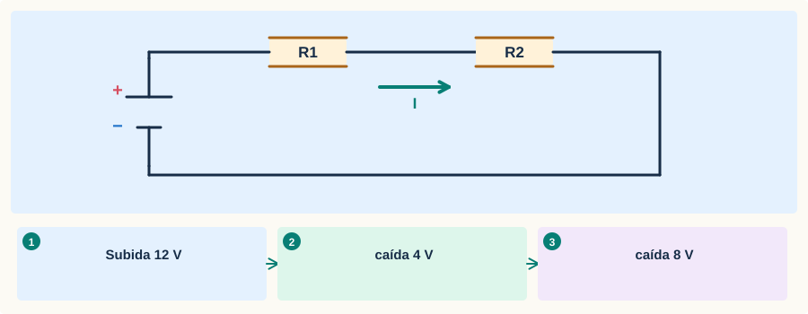

[← Portada](../README.md) · [Índice](../README.md) · [Siguiente →](02.md)

# 01 · Balance por unidad de carga

*Diagrama didáctico y secuencia conceptual; no a escala.*

## ¿Qué es y por qué ocurre?

En un lazo de circuito concentrado bajo condiciones habituales (sin flujo magnético variable externo enlazado no modelado), la suma algebraica de tensiones es cero. Una fuente aporta energía por carga y las caídas representan transferencias. Es distinto de KCL: esta suma está en voltios.

## Ejemplo explicado

> 12 V de fuente y caídas 4 V y 8 V: 12−4−8=0 V.

## Ahora tú

Fuente 9 V y caída 3 V. ¿Otra caída en lazo simple?

[← Portada](../README.md) · [Índice](../README.md) · [Siguiente →](02.md)
