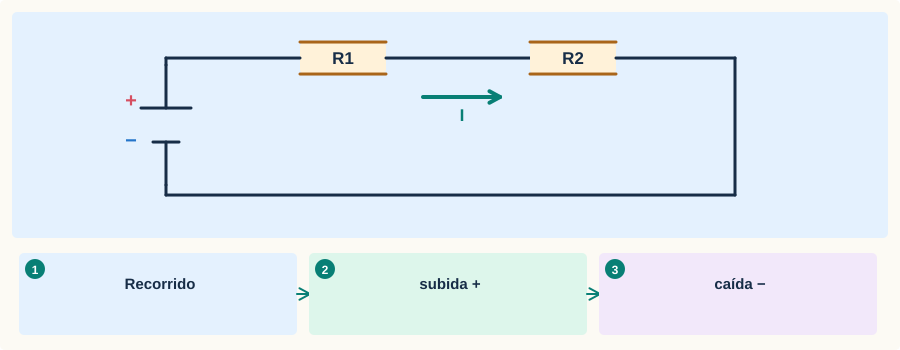
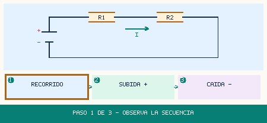

[← Anterior](01.md) · [Índice](../README.md) · [Siguiente →](03.md)

# 02 · Signos al recorrer una malla

*Diagrama didáctico y secuencia conceptual; no a escala.*

## ¿Qué es y por qué ocurre?

Elige un sentido de recorrido. Al pasar de − a + de una fuente, cuenta +V; de + a −, −V. En resistor con corriente convencional, recorrer en su sentido es −IR; en contra +IR. Mantén las referencias hasta resolver.

## Ejemplo explicado

> Recorrido de pila − a + de 6 V y resistor en sentido de I: +6−IR=0.

## Ahora tú

¿Qué signo tiene una caída de 2 V recorrida de − a +?

## Secuencia animada

*Se resaltan etapas del diagrama, no se pretende simular el movimiento físico real.*

[← Anterior](01.md) · [Índice](../README.md) · [Siguiente →](03.md)
