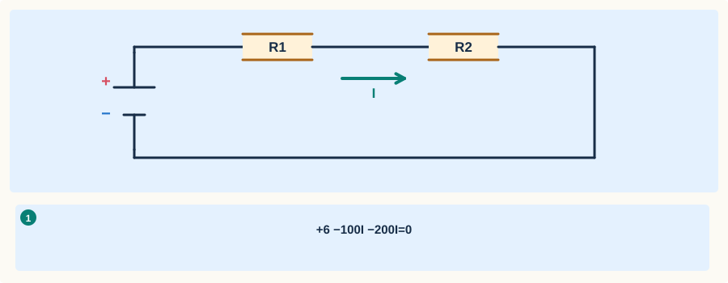

[← Anterior](02.md) · [Índice](../README.md) · [Siguiente →](04.md)

# 03 · Una malla, una corriente

*Diagrama didáctico y secuencia conceptual; no a escala.*

## ¿Qué es y por qué ocurre?

Con fuente 6 V y resistores 100 Ω y 200 Ω en serie, KVL: +6−100I−200I=0; I=6/300=0,02 A. V1=2 V y V2=4 V. Verifica cierre y potencia.

## Ejemplo explicado

> Pfuente=0,12 W; P1=0,04 W y P2=0,08 W.

## Ahora tú

9 V, 300 Ω y 600 Ω. Resuelve I y caídas.

[← Anterior](02.md) · [Índice](../README.md) · [Siguiente →](04.md)
