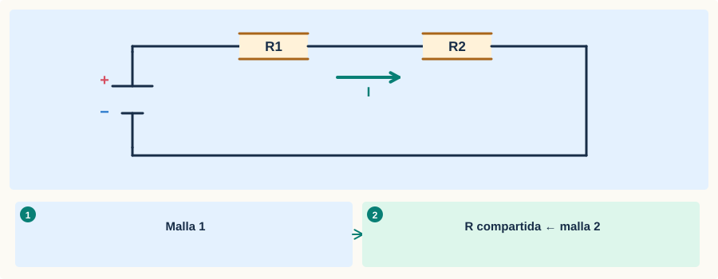

[← Anterior](03.md) · [Índice](../README.md) · [Siguiente →](05.md)

# 04 · Dos mallas: elemento compartido

*Diagrama didáctico y secuencia conceptual; no a escala.*

## ¿Qué es y por qué ocurre?

En dos mallas con corrientes de malla I1 e I2 elegidas horarias, la corriente de una resistencia compartida puede ser I1−I2 en la referencia de la primera. Las ecuaciones incluyen esa diferencia. El método exige signos consistentes, no sumar siempre ambas corrientes.

## Ejemplo explicado

> Con R1=R2=Rcomp=1 kΩ, fuentes orientadas para subidas de 6 V y 0 V: 2I1−I2=6; −I1+2I2=0 (I en mA). I1=4 mA, I2=2 mA.

## Ahora tú

En el ejemplo, ¿corriente en resistor común según primera malla?

[← Anterior](03.md) · [Índice](../README.md) · [Siguiente →](05.md)
