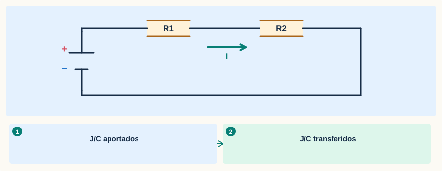

[← Anterior](04.md) · [Índice](../README.md) · [Siguiente →](06.md)

# 05 · Energía, potencia y límites

*Diagrama didáctico y secuencia conceptual; no a escala.*

## ¿Qué es y por qué ocurre?

KVL cierra potenciales en lazos del modelo; el balance energético completo incluye energía almacenada, disipada o transferida. Cuando hay flujo magnético variable enlazado, Faraday exige incluir la FEM inducida o un modelo electromagnético; no aplicar KVL ingenuamente a cualquier contorno.

## Ejemplo explicado

> Una fuente de 3 V transfiere 3 J por C; dos caídas de 1 V y 2 V transfieren 1 y 2 J por C.

## Ahora tú

¿Qué unidad sumas en KVL y cuál en KCL?

[← Anterior](04.md) · [Índice](../README.md) · [Siguiente →](06.md)
