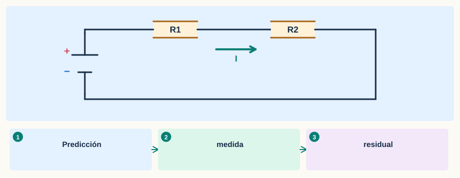

[← Anterior](05.md) · [Índice](../README.md) · [Actividades y cierre →](../descargas.md)

# 06 · Diagnóstico de una malla

*Diagrama didáctico y secuencia conceptual; no a escala.*

## ¿Qué es y por qué ocurre?

Antes de energizar, predice caídas y verifica potencia. Mide voltajes entre los pares de nodos correctos; no hagas cortos para comprobar KVL. El residual de medida no será necesariamente cero exacto por tolerancia, contactos e incertidumbre. Registra referencia y signo.

## Ejemplo explicado

> Medidas 3,02 V, 1,20 V y 1,80 V dan residual 0,02 V.

## Ahora tú

¿Residual 0,02 V prueba automáticamente violación de conservación?

[← Anterior](05.md) · [Índice](../README.md) · [Actividades y cierre →](../descargas.md)
