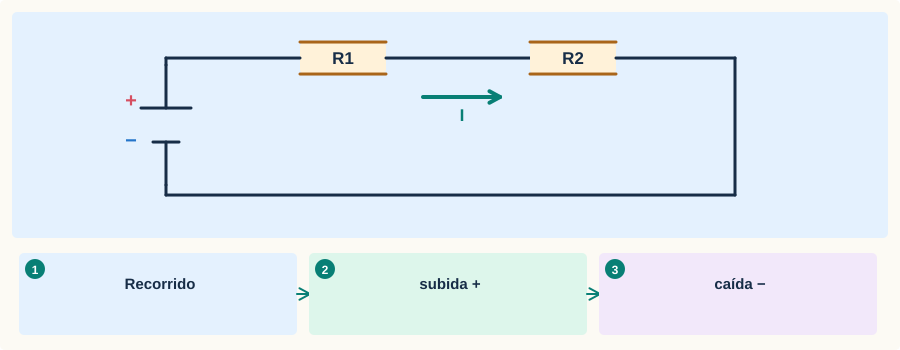

# Práctica guiada · Segunda ley de Kirchhoff: balance de energía

**Objetivo:** ¿Qué significa recuperar en la fuente la energía por unidad de carga?

## Procedimiento

Reutiliza serie de 3 V, 220 Ω y 330 Ω. Predice V1=1,2 V y V2=1,8 V. Mide las tres tensiones con voltímetro en paralelo y referencias marcadas; calcula residual. Resuelve además el ejemplo de dos mallas en papel o simulación.

1. Formula hipótesis y dibuja el modelo antes de intervenir.
2. Identifica magnitudes que cambian y las que permanecen fijas.
3. Realiza solo el procedimiento seguro descrito; registra resultados y unidades.
4. Compara con predicción; explica diferencias, incertidumbre y limitaciones.

| Ensayo | Condiciones | Predicción | Observación o cálculo | Explicación |
|---|---|---|---|---|
| 1 | | | | |
| 2 | | | | |
| 3 | | | | |

Rúbrica: predicción 25, registro 25, explicación 40, presentación 10. Seguridad obligatoria. En simulación, los resultados calculados no son evidencia experimental independiente.

[Simulador complementario PhET](https://phet.colorado.edu/es/simulations/circuit-construction-kit-dc) · [Plantilla de informe](../../../../../plantillas/informe-laboratorio.pdf) · [PDF](018-laboratorio.pdf) · [← Índice](../README.md)
