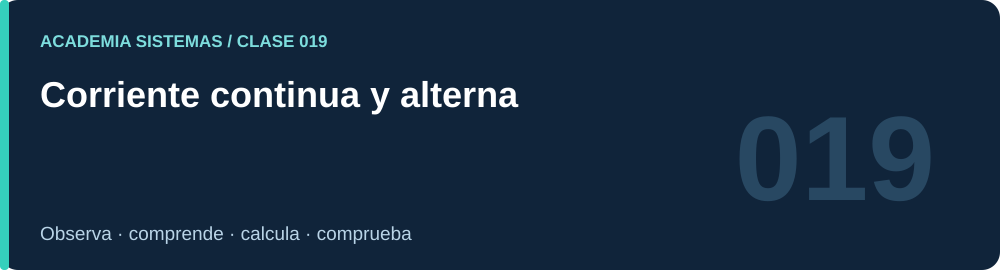
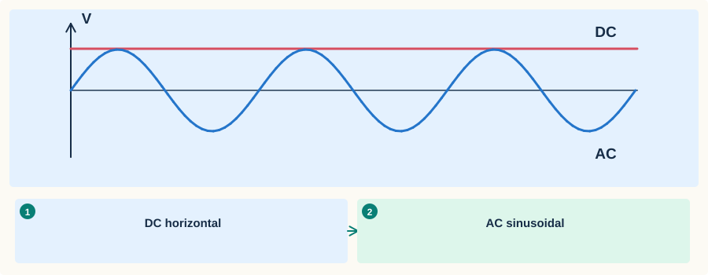

[← Clase 018](../018-kirchhoff-voltajes/README.md) · [Índice](../README.md) · [Clase 020 →](../020-magnetismo-electromagnetismo/README.md)

# Clase 019 · Corriente continua y alterna

**6 temas desarrollados · 120–180 min orientativos, ampliables por dominio.**

> ¿Por qué AC transfiere energía aunque cambie de sentido?

[▶ Comenzar a leer](libro/01.md) · [Libro web](https://mangelmorenomoreno.github.io/academia-sistemas/modulos/01-electronica-basica/clases/019-corriente-continua-alterna/libro.html) · [Descargas](descargas.md)

| Página | Tema |
|---|---|
| 01 | [Corriente continua y alterna](libro/01.md) |
| 02 | [Amplitud, período y frecuencia](libro/02.md) |
| 03 | [Valor eficaz RMS](libro/03.md) |
| 04 | [Energía con sentido alternante](libro/04.md) |
| 05 | [Rectificación y electrónica](libro/05.md) |
| 06 | [Seguridad y aplicaciones](libro/06.md) |

## Material de estudio

[Lectura completa](lecturas/guia-ampliada.md) · [Presentación web](https://mangelmorenomoreno.github.io/academia-sistemas/modulos/01-electronica-basica/clases/019-corriente-continua-alterna/presentacion.html) · [Ejercicios](ejercicios/README.md) · [Práctica](practicas/README.md) · [Evaluación](pruebas/README.md) · [Soluciones](soluciones/README.md) · [Guía docente](guia-docente.md) · [Recursos](recursos/videos-y-simulaciones.md)

> [!CAUTION]
> Prácticas físicas solo con baja tensión, fuente limitada o apropiada y supervisión; desenergiza antes de modificar conexiones. Nunca trabajar con la red doméstica, provocar cortos ni utilizar componentes dañados.

[← Clase 018](../018-kirchhoff-voltajes/README.md) · [Índice](../README.md) · [Clase 020 →](../020-magnetismo-electromagnetismo/README.md)
