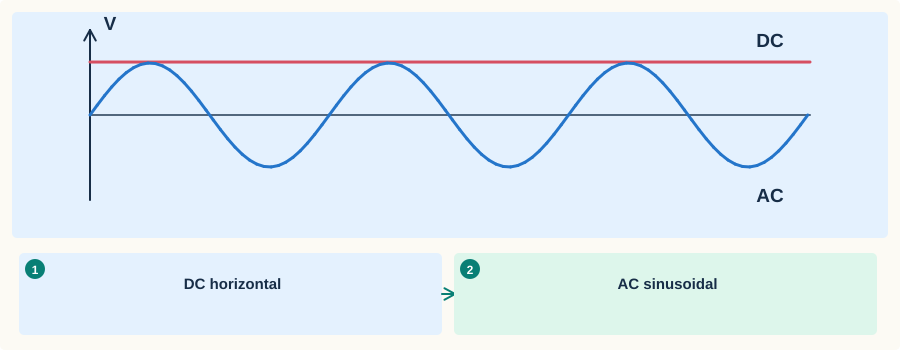
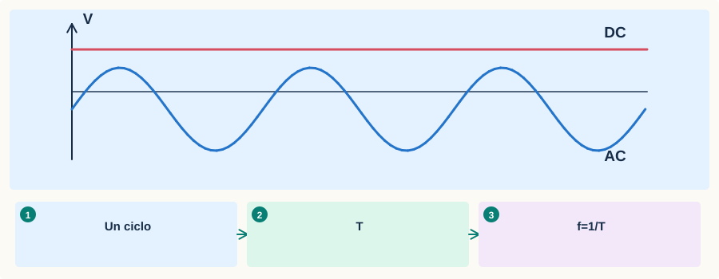
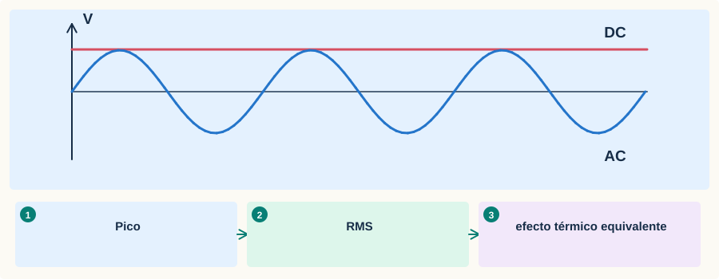
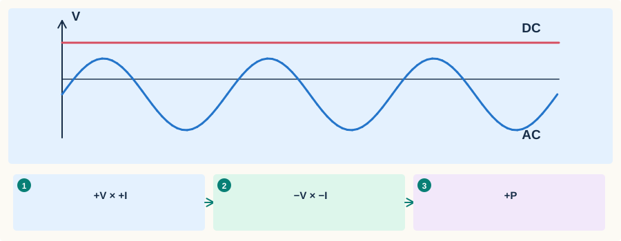
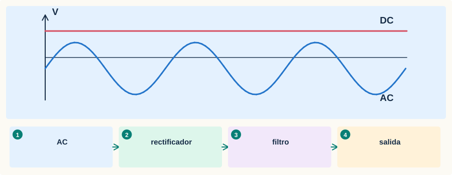
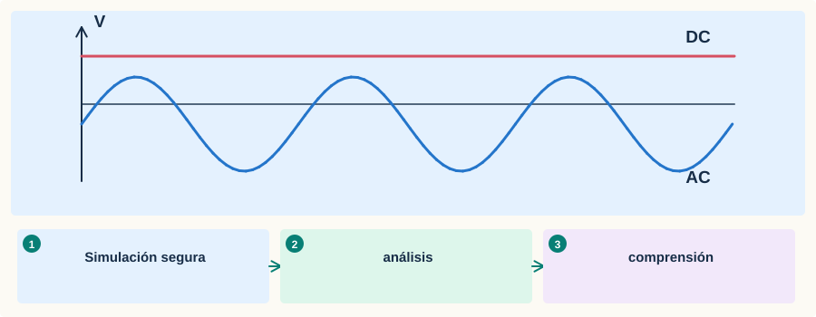

# Cuaderno de ejercicios · Clase 019

[PDF](019-ejercicios.pdf) · [← Índice](../README.md)

## 1. Corriente continua y alterna

**Ejemplo de estudio:** Una pila alimentando un resistor genera DC aproximadamente constante; una señal senoidal ideal alterna.

**Resuelve:** ¿Una corriente que pulsa de 0 a 1 A sin invertir sentido es AC pura?

Escribe datos, procedimiento, unidades (si corresponde), dibujo y justificación. No consultes la solución antes.

## 2. Amplitud, período y frecuencia

**Ejemplo de estudio:** f=50 Hz: T=0,02 s=20 ms.

**Resuelve:** f=200 Hz. Calcula T.

Escribe datos, procedimiento, unidades (si corresponde), dibujo y justificación. No consultes la solución antes.

## 3. Valor eficaz RMS

**Ejemplo de estudio:** Senoide de 10 V pico: Vrms≈7,07 V.

**Resuelve:** Senoide de 4 V pico. ¿Vrms?

Escribe datos, procedimiento, unidades (si corresponde), dibujo y justificación. No consultes la solución antes.

## 4. Energía con sentido alternante

**Ejemplo de estudio:** Con 4 V RMS sobre 100 Ω: Pmedia=16/100=0,16 W.

**Resuelve:** 2 V RMS sobre 200 Ω: Pmedia.

Escribe datos, procedimiento, unidades (si corresponde), dibujo y justificación. No consultes la solución antes.

## 5. Rectificación y electrónica

**Ejemplo de estudio:** Una rectificación de media onda ideal deja pasar una polaridad y bloquea la otra.

**Resuelve:** ¿Una señal rectificada sin filtro tiene magnitud constante?

Escribe datos, procedimiento, unidades (si corresponde), dibujo y justificación. No consultes la solución antes.

## 6. Seguridad y aplicaciones

**Ejemplo de estudio:** Un reloj digital alterna niveles lógicos, pero eso no equivale necesariamente a una senoide de potencia.

**Resuelve:** ¿Se mide red doméstica en esta clase?

Escribe datos, procedimiento, unidades (si corresponde), dibujo y justificación. No consultes la solución antes.
