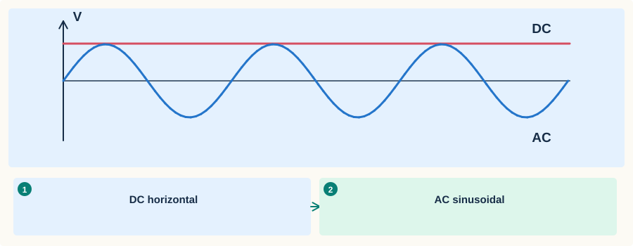
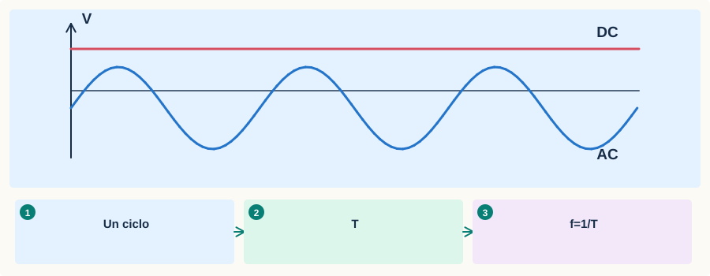
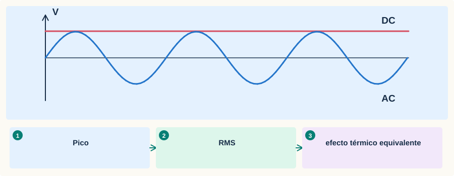
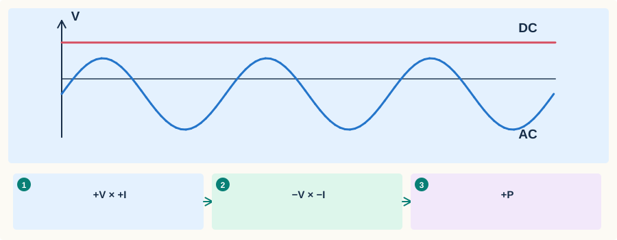
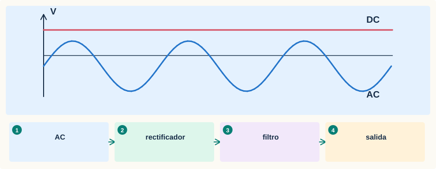
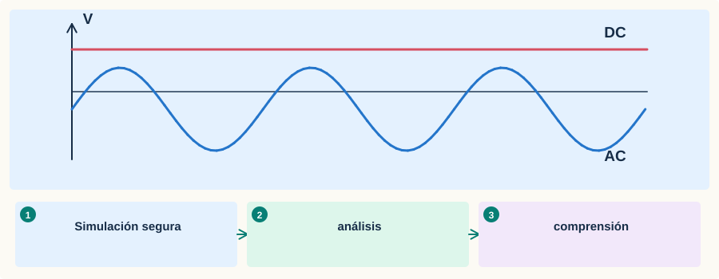

# Corriente continua y alterna

[← Índice](../README.md)

## 01 · Corriente continua y alterna

DC describe una corriente cuyo sentido no cambia, aunque su magnitud puede variar; AC cambia de sentido periódicamente en los ejemplos básicos. Tensión DC tiene polaridad mantenida, mientras una señal AC ideal sinusoidal cambia de signo alrededor de cero. No toda señal variable es sinusoidal.

**Ejemplo:** Una pila alimentando un resistor genera DC aproximadamente constante; una señal senoidal ideal alterna.

**Aplica:** ¿Una corriente que pulsa de 0 a 1 A sin invertir sentido es AC pura?

---

## 02 · Amplitud, período y frecuencia

Una señal senoidal v(t)=Vp sin(2πft) tiene amplitud de pico Vp, período T=1/f y frecuencia f en Hz (ciclos por segundo). Pico a pico es 2Vp para una senoide simétrica. El tiempo se mide en segundos.

**Ejemplo:** f=50 Hz: T=0,02 s=20 ms.

**Aplica:** f=200 Hz. Calcula T.

---

## 03 · Valor eficaz RMS

El valor eficaz de una señal es raíz de la media de su cuadrado. Para senoide sin componente DC, Vrms=Vp/√2. En resistor ideal, una tensión AC RMS produce la misma potencia media que una DC de ese valor. No generalizar esa relación de pico a cualquier onda.

**Ejemplo:** Senoide de 10 V pico: Vrms≈7,07 V.

**Aplica:** Senoide de 4 V pico. ¿Vrms?

---

## 04 · Energía con sentido alternante

En resistor, i(t)=v(t)/R y p(t)=v(t)i(t)=v²(t)/R≥0. Aunque corriente y tensión cambian de signo juntas, su producto sigue positivo. El resistor recibe energía en ambos semiciclos. En elementos reactivos puede devolverse energía en parte del ciclo.

**Ejemplo:** Con 4 V RMS sobre 100 Ω: Pmedia=16/100=0,16 W.

**Aplica:** 2 V RMS sobre 200 Ω: Pmedia.

---

## 05 · Rectificación y electrónica

Los diodos permiten obtener una señal unidireccional a partir de AC mediante rectificación; capacitores y reguladores pueden reducir ondulación. La salida no se vuelve DC perfecta solo por un diodo. En esta clase se estudia conceptual o con simuladores de baja tensión, sin red.

**Ejemplo:** Una rectificación de media onda ideal deja pasar una polaridad y bloquea la otra.

**Aplica:** ¿Una señal rectificada sin filtro tiene magnitud constante?

---

## 06 · Seguridad y aplicaciones

Las fuentes domésticas tienen tensiones peligrosas y no son material de laboratorio de esta ruta inicial. Utiliza simuladores y generadores didácticos aislados apropiados solo bajo supervisión. Los dispositivos digitales utilizan alimentación DC y señales que cambian en el tiempo; distinguir ambas es clave.

**Ejemplo:** Un reloj digital alterna niveles lógicos, pero eso no equivale necesariamente a una senoide de potencia.

**Aplica:** ¿Se mide red doméstica en esta clase?

---
