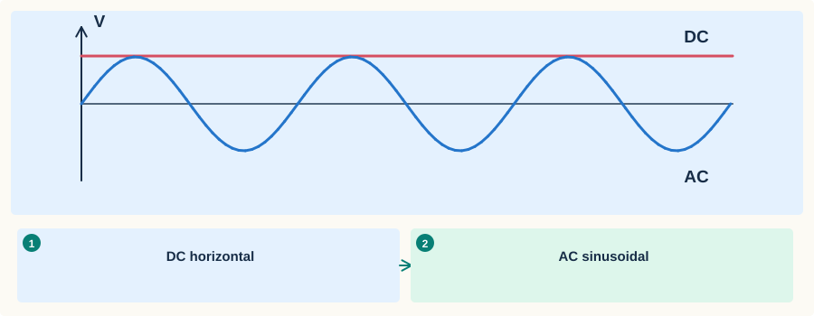

[← Portada](../README.md) · [Índice](../README.md) · [Siguiente →](02.md)

# 01 · Corriente continua y alterna

*Diagrama didáctico y secuencia conceptual; no a escala.*

## ¿Qué es y por qué ocurre?

DC describe una corriente cuyo sentido no cambia, aunque su magnitud puede variar; AC cambia de sentido periódicamente en los ejemplos básicos. Tensión DC tiene polaridad mantenida, mientras una señal AC ideal sinusoidal cambia de signo alrededor de cero. No toda señal variable es sinusoidal.

## Ejemplo explicado

> Una pila alimentando un resistor genera DC aproximadamente constante; una señal senoidal ideal alterna.

## Ahora tú

¿Una corriente que pulsa de 0 a 1 A sin invertir sentido es AC pura?

[← Portada](../README.md) · [Índice](../README.md) · [Siguiente →](02.md)
