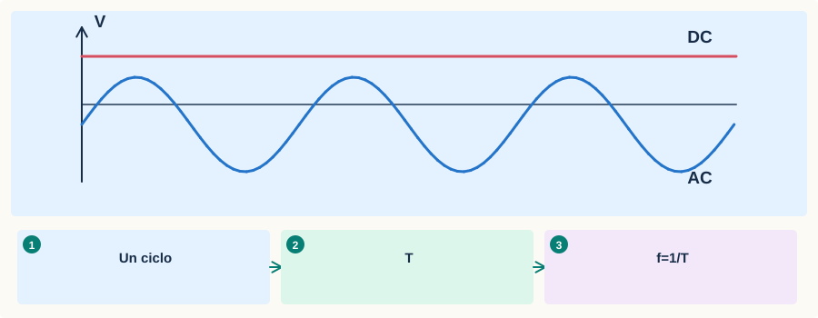
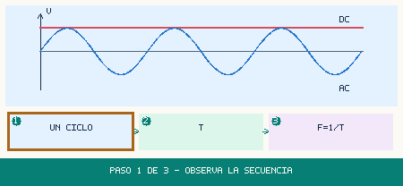

[← Anterior](01.md) · [Índice](../README.md) · [Siguiente →](03.md)

# 02 · Amplitud, período y frecuencia

*Diagrama didáctico y secuencia conceptual; no a escala.*

## ¿Qué es y por qué ocurre?

Una señal senoidal v(t)=Vp sin(2πft) tiene amplitud de pico Vp, período T=1/f y frecuencia f en Hz (ciclos por segundo). Pico a pico es 2Vp para una senoide simétrica. El tiempo se mide en segundos.

## Ejemplo explicado

> f=50 Hz: T=0,02 s=20 ms.

## Ahora tú

f=200 Hz. Calcula T.

## Secuencia animada

*Se resaltan etapas del diagrama, no se pretende simular el movimiento físico real.*

[← Anterior](01.md) · [Índice](../README.md) · [Siguiente →](03.md)
