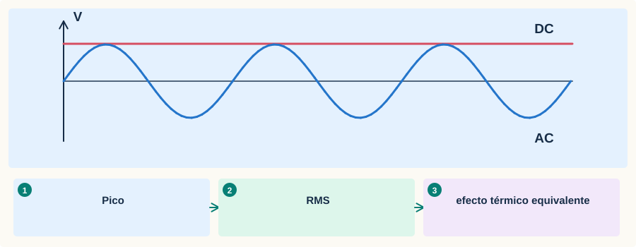

[← Anterior](02.md) · [Índice](../README.md) · [Siguiente →](04.md)

# 03 · Valor eficaz RMS

*Diagrama didáctico y secuencia conceptual; no a escala.*

## ¿Qué es y por qué ocurre?

El valor eficaz de una señal es raíz de la media de su cuadrado. Para senoide sin componente DC, Vrms=Vp/√2. En resistor ideal, una tensión AC RMS produce la misma potencia media que una DC de ese valor. No generalizar esa relación de pico a cualquier onda.

## Ejemplo explicado

> Senoide de 10 V pico: Vrms≈7,07 V.

## Ahora tú

Senoide de 4 V pico. ¿Vrms?

[← Anterior](02.md) · [Índice](../README.md) · [Siguiente →](04.md)
