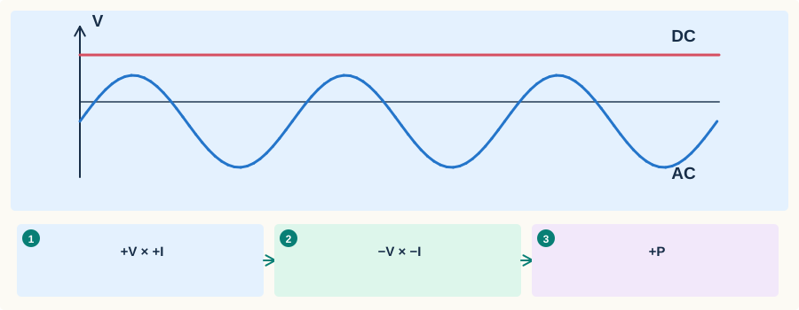

[← Anterior](03.md) · [Índice](../README.md) · [Siguiente →](05.md)

# 04 · Energía con sentido alternante

*Diagrama didáctico y secuencia conceptual; no a escala.*

## ¿Qué es y por qué ocurre?

En resistor, i(t)=v(t)/R y p(t)=v(t)i(t)=v²(t)/R≥0. Aunque corriente y tensión cambian de signo juntas, su producto sigue positivo. El resistor recibe energía en ambos semiciclos. En elementos reactivos puede devolverse energía en parte del ciclo.

## Ejemplo explicado

> Con 4 V RMS sobre 100 Ω: Pmedia=16/100=0,16 W.

## Ahora tú

2 V RMS sobre 200 Ω: Pmedia.

[← Anterior](03.md) · [Índice](../README.md) · [Siguiente →](05.md)
