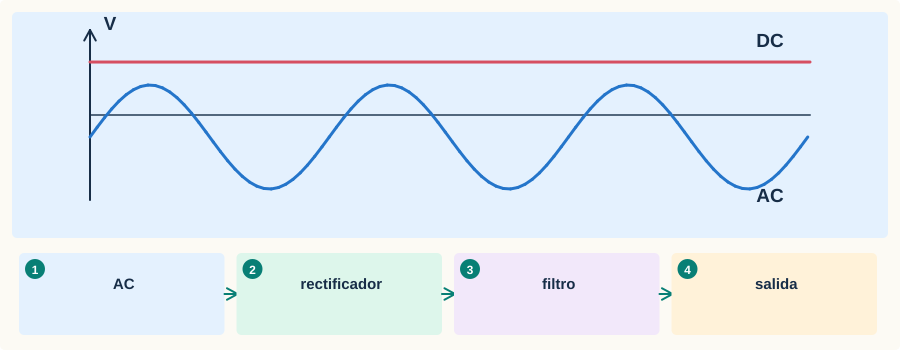

[← Anterior](04.md) · [Índice](../README.md) · [Siguiente →](06.md)

# 05 · Rectificación y electrónica

*Diagrama didáctico y secuencia conceptual; no a escala.*

## ¿Qué es y por qué ocurre?

Los diodos permiten obtener una señal unidireccional a partir de AC mediante rectificación; capacitores y reguladores pueden reducir ondulación. La salida no se vuelve DC perfecta solo por un diodo. En esta clase se estudia conceptual o con simuladores de baja tensión, sin red.

## Ejemplo explicado

> Una rectificación de media onda ideal deja pasar una polaridad y bloquea la otra.

## Ahora tú

¿Una señal rectificada sin filtro tiene magnitud constante?

[← Anterior](04.md) · [Índice](../README.md) · [Siguiente →](06.md)
