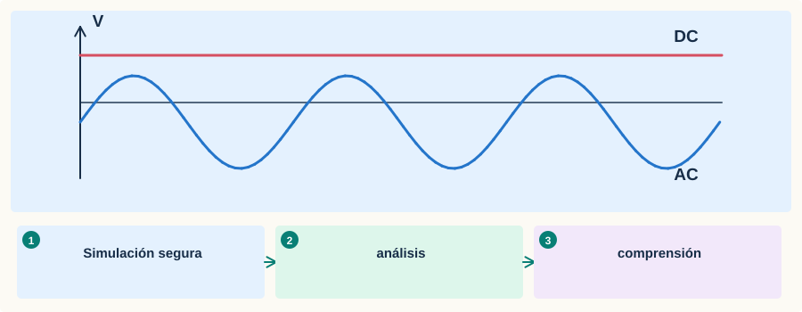

[← Anterior](05.md) · [Índice](../README.md) · [Actividades y cierre →](../descargas.md)

# 06 · Seguridad y aplicaciones

*Diagrama didáctico y secuencia conceptual; no a escala.*

## ¿Qué es y por qué ocurre?

Las fuentes domésticas tienen tensiones peligrosas y no son material de laboratorio de esta ruta inicial. Utiliza simuladores y generadores didácticos aislados apropiados solo bajo supervisión. Los dispositivos digitales utilizan alimentación DC y señales que cambian en el tiempo; distinguir ambas es clave.

## Ejemplo explicado

> Un reloj digital alterna niveles lógicos, pero eso no equivale necesariamente a una senoide de potencia.

## Ahora tú

¿Se mide red doméstica en esta clase?

[← Anterior](05.md) · [Índice](../README.md) · [Actividades y cierre →](../descargas.md)
