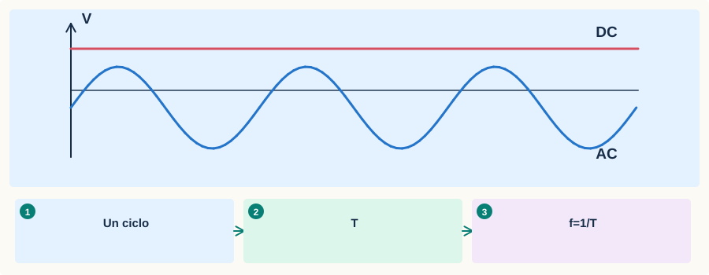

# Práctica guiada · Corriente continua y alterna

**Objetivo:** ¿Por qué AC transfiere energía aunque cambie de sentido?

## Procedimiento

Dibuja tres ciclos de una senoide de 2 V pico a 100 Hz y DC de 2 V. Marca pico, pico a pico, T y RMS. Calcula potencia media en 100 Ω y compara con DC de 2 V. No conectar red eléctrica.

1. Formula hipótesis y dibuja el modelo antes de intervenir.
2. Identifica magnitudes que cambian y las que permanecen fijas.
3. Realiza solo el procedimiento seguro descrito; registra resultados y unidades.
4. Compara con predicción; explica diferencias, incertidumbre y limitaciones.

| Ensayo | Condiciones | Predicción | Observación o cálculo | Explicación |
|---|---|---|---|---|
| 1 | | | | |
| 2 | | | | |
| 3 | | | | |

Rúbrica: predicción 25, registro 25, explicación 40, presentación 10. Seguridad obligatoria. En simulación, los resultados calculados no son evidencia experimental independiente.

[Simulador complementario PhET](https://phet.colorado.edu/es/simulations/circuit-construction-kit-ac) · [Plantilla de informe](../../../../../plantillas/informe-laboratorio.pdf) · [PDF](019-laboratorio.pdf) · [← Índice](../README.md)
