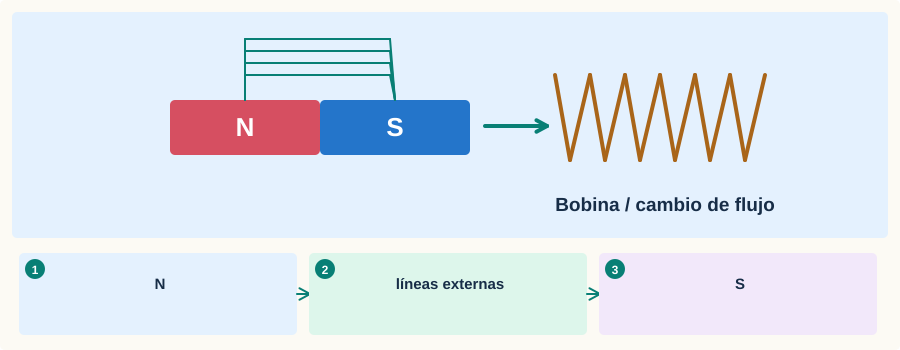
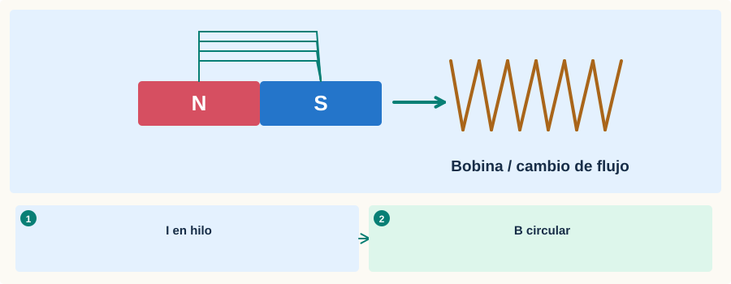
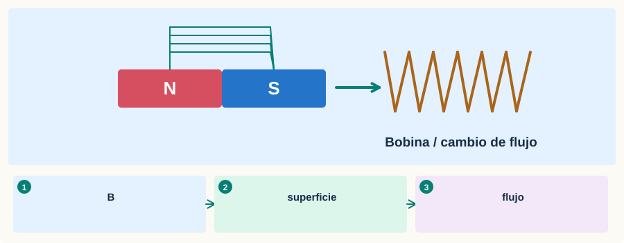
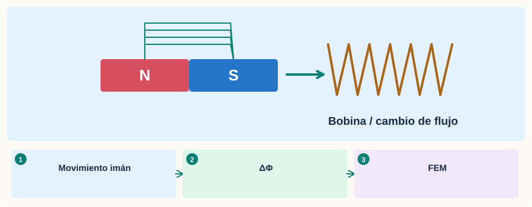
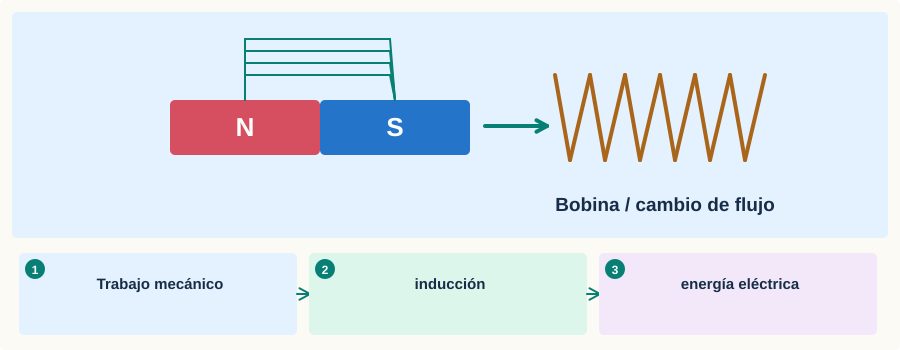

# Cuaderno de ejercicios · Clase 020

[PDF](020-ejercicios.pdf) · [← Índice](../README.md)

## 1. Imanes y campo magnético

**Ejemplo de estudio:** Una brújula cerca de un imán cambia orientación.

**Resuelve:** ¿Una línea de campo magnético termina en un polo aislado en el modelo ordinario?

Escribe datos, procedimiento, unidades (si corresponde), dibujo y justificación. No consultes la solución antes.

## 2. Corriente produce campo magnético

**Ejemplo de estudio:** En hilo recto largo ideal B=μ₀I/(2πr), en vacío.

**Resuelve:** Si duplicas distancia de hilo largo con I fija, ¿B?

Escribe datos, procedimiento, unidades (si corresponde), dibujo y justificación. No consultes la solución antes.

## 3. Bobina y electroimán

**Ejemplo de estudio:** Más vueltas pueden aumentar el campo si corriente y geometría se mantienen, pero también cambian resistencia e inductancia.

**Resuelve:** ¿Más vueltas garantizan más campo con cualquier fuente fija?

Escribe datos, procedimiento, unidades (si corresponde), dibujo y justificación. No consultes la solución antes.

## 4. Flujo magnético

**Ejemplo de estudio:** B=0,2 T, A=0,01 m², θ=0°: Φ=0,002 Wb.

**Resuelve:** Misma superficie a 90°. ¿Φ?

Escribe datos, procedimiento, unidades (si corresponde), dibujo y justificación. No consultes la solución antes.

## 5. Ley de Faraday y Lenz

**Ejemplo de estudio:** 50 espiras, ΔΦ=0,002 Wb en 0,1 s: |ε|=1 V.

**Resuelve:** 100 espiras, cambio 0,001 Wb en 0,2 s. ¿Magnitud FEM?

Escribe datos, procedimiento, unidades (si corresponde), dibujo y justificación. No consultes la solución antes.

## 6. Aplicaciones: motor, generador, transformador

**Ejemplo de estudio:** Mover un imán más rápido en una bobina puede aumentar FEM si el cambio de flujo por recorrido es el mismo.

**Resuelve:** ¿Por qué un imán inmóvil respecto a una bobina no induce tensión sostenida por sí solo?

Escribe datos, procedimiento, unidades (si corresponde), dibujo y justificación. No consultes la solución antes.
