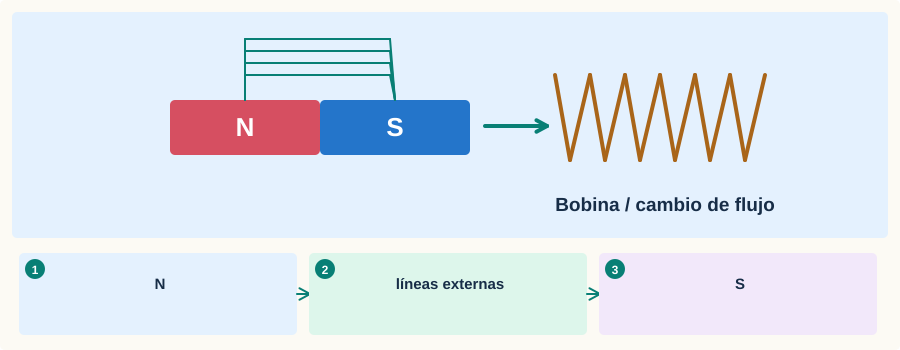
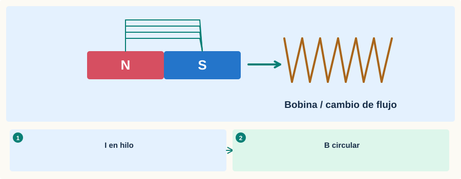
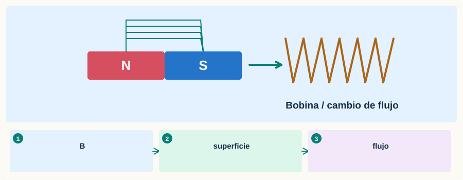
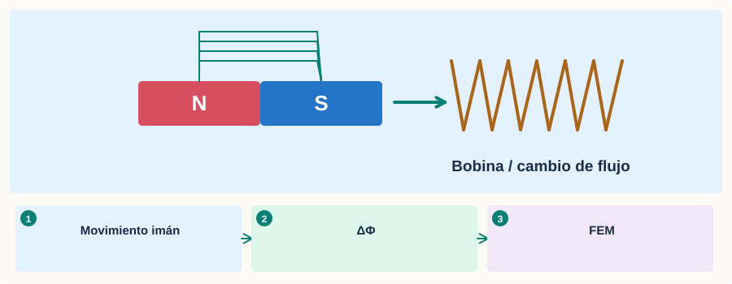
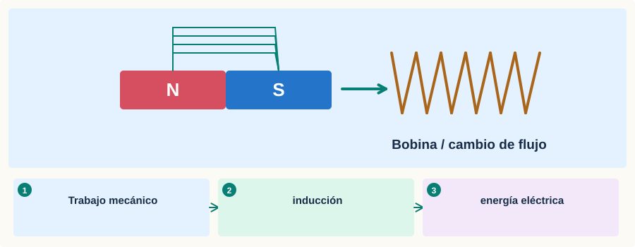

# Magnetismo y electromagnetismo básico

[← Índice](../README.md)

## 01 · Imanes y campo magnético

Un imán tiene dos polos y un campo magnético B, medido en teslas (T). Las líneas externas se dibujan de norte a sur y cierran por dentro del imán. No son objetos materiales. Una brújula se orienta aproximadamente según el campo local; los campos pueden superponerse.

**Ejemplo:** Una brújula cerca de un imán cambia orientación.

**Aplica:** ¿Una línea de campo magnético termina en un polo aislado en el modelo ordinario?

---

## 02 · Corriente produce campo magnético

Una corriente en un conductor genera un campo magnético alrededor del conductor. La regla de mano derecha indica sentido: pulgar en dirección de corriente convencional, dedos se curvan según B. Al invertir corriente se invierte el sentido del campo. La magnitud depende de geometría, corriente y distancia.

**Ejemplo:** En hilo recto largo ideal B=μ₀I/(2πr), en vacío.

**Aplica:** Si duplicas distancia de hilo largo con I fija, ¿B?

---

## 03 · Bobina y electroimán

Las contribuciones del campo de las vueltas de una bobina se suman. Un núcleo ferromagnético puede aumentar el flujo, con límites como saturación. Un electroimán convierte energía eléctrica en campo magnético y puede ejercer fuerzas; una bobina real también disipa calor.

**Ejemplo:** Más vueltas pueden aumentar el campo si corriente y geometría se mantienen, pero también cambian resistencia e inductancia.

**Aplica:** ¿Más vueltas garantizan más campo con cualquier fuente fija?

---

## 04 · Flujo magnético

En campo uniforme y superficie plana, Φ=B A cosθ, con θ entre B y la normal a la superficie. Se mide en webers (Wb). No es simplemente el valor de B: también importan área y orientación.

**Ejemplo:** B=0,2 T, A=0,01 m², θ=0°: Φ=0,002 Wb.

**Aplica:** Misma superficie a 90°. ¿Φ?

---

## 05 · Ley de Faraday y Lenz

La FEM inducida media en N espiras es ε=−N ΔΦ/Δt si cada espira tiene el mismo flujo. El signo de Lenz indica que el efecto de la corriente inducida se opone al cambio de flujo que la produce. No hay FEM por flujo constante en este modelo; importa el cambio.

**Ejemplo:** 50 espiras, ΔΦ=0,002 Wb en 0,1 s: |ε|=1 V.

**Aplica:** 100 espiras, cambio 0,001 Wb en 0,2 s. ¿Magnitud FEM?

---

## 06 · Aplicaciones: motor, generador, transformador

Un motor convierte energía eléctrica en trabajo mecánico mediante interacciones electromagnéticas; un generador transforma trabajo mecánico en energía eléctrica. Un transformador usa flujo variable para acoplar bobinas; no se estudia físicamente con red en este curso. Los campos y sus energías se conservan en el balance total.

**Ejemplo:** Mover un imán más rápido en una bobina puede aumentar FEM si el cambio de flujo por recorrido es el mismo.

**Aplica:** ¿Por qué un imán inmóvil respecto a una bobina no induce tensión sostenida por sí solo?

---
