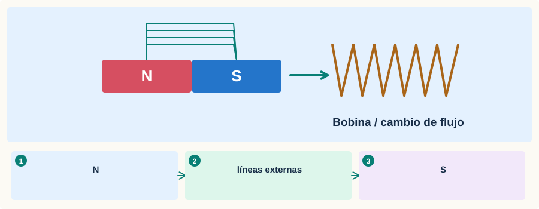

[← Portada](../README.md) · [Índice](../README.md) · [Siguiente →](02.md)

# 01 · Imanes y campo magnético

*Diagrama didáctico y secuencia conceptual; no a escala.*

## ¿Qué es y por qué ocurre?

Un imán tiene dos polos y un campo magnético B, medido en teslas (T). Las líneas externas se dibujan de norte a sur y cierran por dentro del imán. No son objetos materiales. Una brújula se orienta aproximadamente según el campo local; los campos pueden superponerse.

## Ejemplo explicado

> Una brújula cerca de un imán cambia orientación.

## Ahora tú

¿Una línea de campo magnético termina en un polo aislado en el modelo ordinario?

[← Portada](../README.md) · [Índice](../README.md) · [Siguiente →](02.md)
