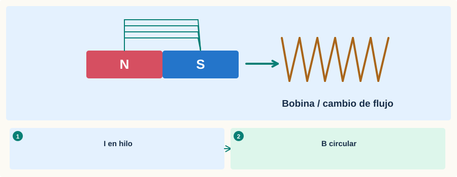
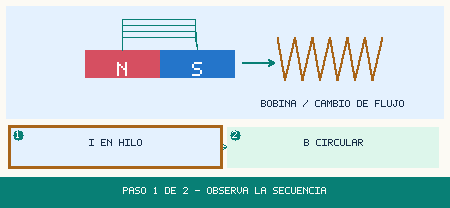

[← Anterior](01.md) · [Índice](../README.md) · [Siguiente →](03.md)

# 02 · Corriente produce campo magnético

*Diagrama didáctico y secuencia conceptual; no a escala.*

## ¿Qué es y por qué ocurre?

Una corriente en un conductor genera un campo magnético alrededor del conductor. La regla de mano derecha indica sentido: pulgar en dirección de corriente convencional, dedos se curvan según B. Al invertir corriente se invierte el sentido del campo. La magnitud depende de geometría, corriente y distancia.

## Ejemplo explicado

> En hilo recto largo ideal B=μ₀I/(2πr), en vacío.

## Ahora tú

Si duplicas distancia de hilo largo con I fija, ¿B?

## Secuencia animada

*Se resaltan etapas del diagrama, no se pretende simular el movimiento físico real.*

[← Anterior](01.md) · [Índice](../README.md) · [Siguiente →](03.md)
