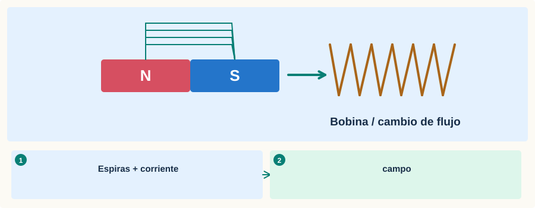

[← Anterior](02.md) · [Índice](../README.md) · [Siguiente →](04.md)

# 03 · Bobina y electroimán

*Diagrama didáctico y secuencia conceptual; no a escala.*

## ¿Qué es y por qué ocurre?

Las contribuciones del campo de las vueltas de una bobina se suman. Un núcleo ferromagnético puede aumentar el flujo, con límites como saturación. Un electroimán convierte energía eléctrica en campo magnético y puede ejercer fuerzas; una bobina real también disipa calor.

## Ejemplo explicado

> Más vueltas pueden aumentar el campo si corriente y geometría se mantienen, pero también cambian resistencia e inductancia.

## Ahora tú

¿Más vueltas garantizan más campo con cualquier fuente fija?

[← Anterior](02.md) · [Índice](../README.md) · [Siguiente →](04.md)
