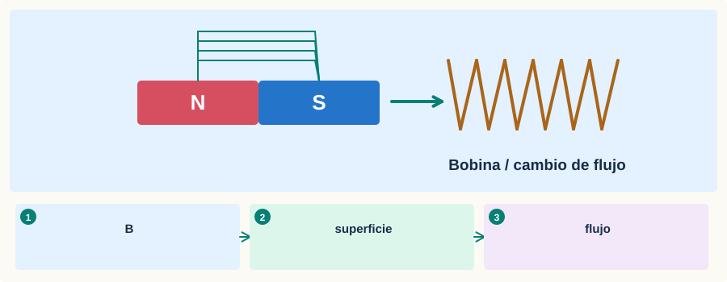

[← Anterior](03.md) · [Índice](../README.md) · [Siguiente →](05.md)

# 04 · Flujo magnético

*Diagrama didáctico y secuencia conceptual; no a escala.*

## ¿Qué es y por qué ocurre?

En campo uniforme y superficie plana, Φ=B A cosθ, con θ entre B y la normal a la superficie. Se mide en webers (Wb). No es simplemente el valor de B: también importan área y orientación.

## Ejemplo explicado

> B=0,2 T, A=0,01 m², θ=0°: Φ=0,002 Wb.

## Ahora tú

Misma superficie a 90°. ¿Φ?

[← Anterior](03.md) · [Índice](../README.md) · [Siguiente →](05.md)
